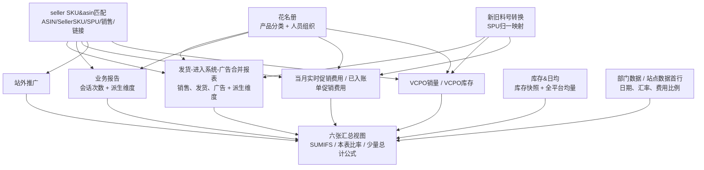
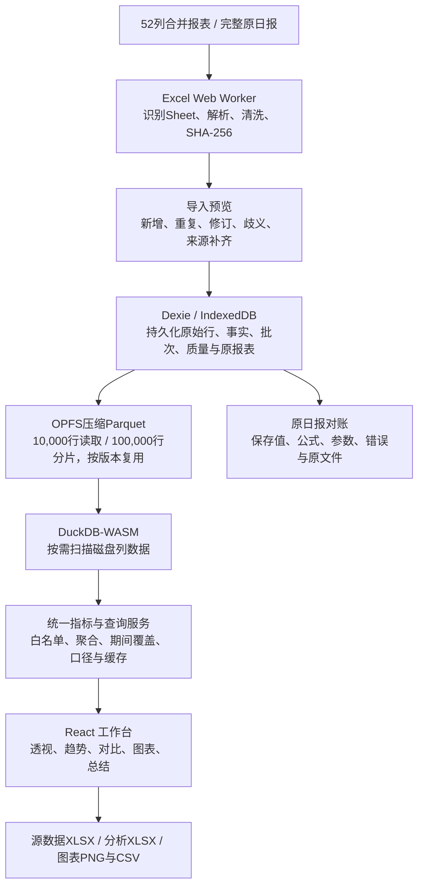

# 精品日报解构与可视化系统设计

> 2026-10-22，3.5.0：VCPO兼容月份表头、缺日期和缺转换列。月归属可确定才补1日，原始值/补齐依据保留，实际日日期不改；4月格式尾行不作为百万业务行。图表新增单对象两指标合图/独立双轴/柱线以及全局平滑选项。现行规则见完整说明和 [十文件核查](VCPO_COMPATIBILITY_20261022.md)。

> 2026-10-21，3.4.0：新增YYYY-MM月份维度、独立的按月时间模式及不连续月份筛选；支持月份/销售组合层级、多对象月份对比、分指标图、排序导出和设置记忆。按月汇总复用单月财务口径，保留费用原日期及实时特殊TOTAL，跳过的月份不计入。现行规则及操作见 [完整说明4.1和7.1节](精品日报原理以及使用说明.md)。

> 2026-10-21，3.3.1：兼容旧版促销缺少新旧料号转换及Original balance列名，修复7/8月误判缺源；保留原费用日期和特殊TOTAL。四文件差异见 [调查记录](PROMOTION_SOURCE_AUDIT_20261021.md)。当前已删除对账页面/TOTAL入口，保留两种范围；跨月参数自动设置，费用逐月归属、缺表/空表整月归零，处理记录集中数据质量；完整备份默认gzip。当前架构与操作以 [精品日报原理以及使用说明.md](精品日报原理以及使用说明.md) 为准，以下保留历史Excel解构证据。

> 2026-10-19版本提示：本文件保留原Excel解构、公式和历史设计证据。当前3.2.0规则见 [精品日报原理以及使用说明.md](精品日报原理以及使用说明.md)：四来源按表头识别、费用独立增量和期间确认；缺源显示带标记参考值，站外全局固定0；库存三项移除；全站原币TOTAL按原表USD规则；36项TOTAL结果见 [四来源核对](FOUR_SOURCE_TOTAL_RECONCILIATION.md)。分页面指标记忆及完整备份继续保留。下文历史架构不覆盖这些规则，第10章证据附录保持原样。

分析对象：`未加密-精品日报-202609.xlsx`；实现项目：当前目录中的“精品日报 · Amazon 经营分析”Web App。

原表分析日期：2026-10-13。网页设计与实现更新日期：2026-10-16。原表重点范围：站点SPU销售数据、站点SPU数据、尺寸类型数据、产品类型数据、站点数据、部门数据；本次补充每日销售数据-集合的毛利引用链和当前网页设计。

本文区分四种信息：**原 Excel 的实际公式与保存值**、**业务含义解释**、**当前网页已实现的行为**、**后续扩展建议**。第2—4章和第10章保留原工作簿的解构与证据，第5—6章说明指标及兼容边界，第7—9章记录当前网页的架构、交互与验收。原工作簿只读分析，没有修改。

**当前约定：严格保留原日报行为。** 原日报对账展示保存时的公式、参数、结果、错误和特殊总计；动态分析按选定原表口径重新聚合，明确其来源和适用范围，不声称任意维度组合都等于某个原表单元格。发现原表问题不意味着自动修正原文件或启用新口径。

当前网页为可运行的纯浏览器本地工作台，已支持增量导入、经营透视、日期汇总、图表、数据质量、数据管理及原日报对账。启动方式见第9章。相关说明：[项目说明](README.md)、[毛利核对与修复](PROFIT_RECONCILIATION.md)、[验收记录](VALIDATION.md)、[界面设计约定](design-system/MASTER.md)。

**V3扩展更新（2026-10-16）：**已改为Chrome Manifest V3扩展“精品日报”，147图标、独立标签页，网页开发入口保留。顶部动态口径选择条移除，普通分析使用默认组织公式；ASIN支持商品短链、同站多选聚合、可选指标列和排序。百万行仓库改用IndexedDB持久事实与OPFS Parquet磁盘分析分片，增加完整仓库备份恢复。详见 [扩展使用说明](EXTENSION_GUIDE.md) 和 [字段规则与来源](FIELD_RULES.md)。

## 目录

1. [关键结论](#1-关键结论)
2. [全局来源关系](#2-全局来源关系)
3. [底层明细和维度映射](#3-底层明细和维度映射)
4. [六张汇总表逐一解构](#4-六张汇总表逐一解构)
5. [指标字典和计算口径](#5-指标字典和计算口径)
6. [原表问题与兼容策略](#6-原表问题与兼容策略)
7. [可视化系统数据模型](#7-可视化系统数据模型)
8. [网页设计与交互](#8-网页设计与交互)
9. [运行与验收](#9-运行与验收)
10. [证据附录](#10-证据附录)

## 1. 关键结论

### 1.1 六张表是六种分析视角

它们主要从同一批底层明细独立做条件汇总。不能把它们当作六份不同收入来源相加，也不能假定“销售SPU表相加必然等于SPU表，再相加必然等于部门表”。映射键、人员覆盖范围、平台筛选、产品分类和总计公式会造成差异。

| 目标 sheet | 主要分析粒度 | 关键定位字段 | 实际结构 |
|---|---|---|---|
| 站点SPU销售数据 | 平台筛选下的站点 × SPU × 销售 | C 站点、D SPU、E 销售、F 拼接键 | 第 3 行表头，第 4 行起主体；右侧有辅助列表 |
| 站点SPU数据 | 平台筛选下的站点 × SPU | C 站点、D SPU、E 拼接键 | 第 3 行表头，第 4 行起主体；BD 后有辅助列 |
| 尺寸类型数据 | 尺寸、尺寸系列，结合站点/部门/团队 | 不同区块的 A/B/C/D 意义变化 | 六个区块，不能按单一表头读取整张表 |
| 产品类型数据 | 产品系列、产品大类、细化分支，结合站点/部门 | A 分类、C 站点、D 部门 | 六个区块，“产品类型”并非始终同一层级 |
| 站点数据 | 平台 × 站点，及站点 × 部门/团队/销售 | A 平台、C 站点、D 组织字段、E 拼接键 | 四个区块 |
| 部门数据 | 平台 × 部门/团队/销售 | A 平台、D 组织字段 | 三个区块，夹杂平台合计与人员合计 |

### 1.2 数据期间与表头日期冲突

销售合并明细和 VCPO 销量实际覆盖 **2026-09-01 至 2026-09-30**。但 `部门数据!D1` 的 `TODAY()` 缓存为 **2026-10-13**，`H1=DAY(TODAY()-1)` 为 **12**，`F1` 的本月天数为 **31**。SPU 表及其他表从这些单元格继承参数。

大多数累计金额公式没有日期条件，而是汇总整张来源表，因此金额实质是来源文件里的九月数据。库存公式却使用 `TODAY()-1`，目前试图取 **2026-10-12**。库存来源的有效日期仅在九月，代表性库存查询没有匹配记录，结果仍显示 0。

**系统必须分别记录报表期间、业务日期、库存快照日期、各来源覆盖日期和导入时间。不能用打开报表当天的日期代替这些字段。**

### 1.3 部分字段名称与实际内容不同

- “进入系统订单”实际汇总合并表 T 列，源表头是 **进入系统-PCS**。它是件数口径，不能直接作为独立订单数。
- “客单价”实际是 **发货销售额 ÷ 发货件数**，更接近单件发货均价。
- 产品类型表 A 列常见“重型蓬、仿尖顶”等，实际对应“产品系列”；“帐篷、行李箱”等出现在另一个“产品线分类”区块，对应真正的产品类型字段。
- `站点SPU销售数据!X4` 的“与花费最高竞对占比”，实际在本表同站点同 SPU 的销售人员之间比较广告花费，来源不包含市场竞争对手数据。
- `尺寸类型数据` 最后一个区块的 R 列改为广告花费份额，不能继续作为“广告销售额原币”导入。

### 1.4 当前系统结构与对账边界

当前采用React + TypeScript的浏览器/扩展本地架构：Excel Worker解析，IndexedDB保存原始行和有效事实，OPFS保存可重建的压缩Parquet分片，DuckDB-WASM按需查询磁盘列数据，统一指标服务计算，ECharts展示。业务文件不上传服务器，没有远程业务API或后端数据库。

支持两类输入：52列合并报表用于日常增量经营分析；完整日报额外保留原文件、原表缓存、公式、参数和四类附表。原日报对账与动态分析分开：前者保留原表行为，后者按来源支持的维度、期间和选定公式计算。库存、流量等独立来源尚未全部接入动态分析，不能因完整原文件已保存就宣称所有字段都可计算。

## 2. 全局来源关系

### 2.1 核心依赖图



这是业务主线图，不是工作簿所有依赖的完整图。实际还存在配置引用回路：例如合并表 AB 列读取 `每日销售数据-集合!AQ1` 的美元汇率，该汇率再来自部门表首行。`花名册` 有查询 SPU 汇总表和合并表的辅助区域。系统实现时应把配置、产品维度、组织维度拆为独立来源，避免把辅助查询视为产品主数据。

### 2.2 数据透视表的真实位置

这份工作簿有 3 个数据透视表，全部位于 `发货-进入系统-广告合并报表`，不在这六张目标表内：

| 位置 | 行维度 | 列维度 | 筛选维度 | 汇总指标 |
|---|---|---|---|---|
| BB3:CA35 | 日期-合 | 销售 | 平台-合 | S 列进入系统不含税销售额 USD 求和 |
| CG3:CS35 | 日期-合 | 团队 | 平台-合 | 同上 |
| CX3:DD35 | 日期-合 | 部门 | 平台-合 | 同上 |

三者共用一个透视缓存，声明来源为 `发货-进入系统-广告合并报表!A1:AK1048576`。这里的 1,048,576 是整列范围上界，不是实际明细条数。核心合并明细为第 2 至 52617 行，共 52,616 行。

**导入合并表时，业务事实范围应限制到 A:AZ；BB:DD 是旁边的透视结果，不能再次导入当作明细。**

## 3. 底层明细和维度映射

### 3.1 发货-进入系统-广告合并报表

这是销售、发货与广告的共同汇总来源。原始数据导出和三类数据如何在外部合并，工作簿没有保留完整处理程序，无法仅凭本文件确认原始关联规则或重复清理规则。

可观察的粒度是日期、平台、站点、账号、SPU/SKU/SellerSKU/ASIN 的明细记录。**尚未证明该组合是唯一键**，实施时需要导入后校验。

| 列 | 内容 | 系统建议字段 |
|---|---|---|
| A/B/C/D | 平台、站点、日期、账号 | platform/site/business_date/account_id |
| E/F/G/H | 原始 SPU、SKU、SellerSKU、ASIN | original_spu/sku/seller_sku/asin_raw |
| I/J/K | 原始部门、团队、销售 | source_department/source_team/source_sales |
| L/M | 发货订单数、发货 PCS | shipped_orders/shipped_units |
| N/O | 发货不含税付款金额 USD/CNY | shipped_revenue_usd/cny |
| P/Q/R | SKU 毛利、站内推广费 CNY、预估退款 CNY | sku_profit_raw/promotion_cost_cny/refund_estimate_cny |
| S/T | 进入系统不含税销售额 USD、进入系统 PCS | system_revenue_usd/system_units |
| U/V | 广告花费 USD/CNY | ad_spend_usd/cny |
| W/X | 广告销售额 USD/CNY | ad_revenue_usd/cny |
| Y/Z/AA | 广告订单、曝光、点击 | ad_orders/impressions/clicks |
| AB | 不扣除推广费的发货毛利 USD | gross_before_marketing_usd |
| AC | 处理后的 ASIN | asin_resolved |
| AE/AH | 站点&新料号SPU / 站点&新料号SPU&销售 | 用结构化字段替代拼接键 |
| AI/AJ/AK/AR | 匹配后团队、销售、部门、小组 | team_id/sales_id/department_id/group_id |
| AO/AP | 链接标识、链接包含的 SPU | listing_id/listing_spus |
| AQ/AZ | 解析出的 SPU、转换后的 SPU | resolved_spu/canonical_spu |
| AT/AU/AV/AW | 产品系列、产品类型、细化分支、尺寸 | product_series/product_type/product_branch/size |
| AX/AY | 尺寸系列、尺寸系列分支 | 兼容原表的组合分类字段 |

关键公式链，以第 2 行为例：

1. `AC2`：H 原始 ASIN 非空时使用 H；否则从 G SellerSKU 到匹配表 H:I 查 ASIN；失败标记“未认领”。
2. `AJ2`：按 AC 的 ASIN 在匹配表 I:J 查销售，加 `销售-` 前缀。这里没有同时使用账号/站点条件。
3. `AI2/AK2/AR2`：按销售标签到花名册 W:Z 获取团队、部门、小组。部门未找到时可回退原始 I 列。
4. `AQ2`：E 原始 SPU 非空则用 E；否则由 ASIN 查匹配表 SPU。
5. `AZ2`：先查新旧料号表 C:E，第 3 列 E；再查 D:E 的 E；均失败则保留 AQ。
6. `AE2=B2&AZ2`，`AH2=B2&AZ2&AJ2`。
7. `AT2:AW2`：按 **AQ 原始/解析 SPU** 到花名册 P:U 找分类，而不是按 AZ 转换后的 SPU。
8. `AB2=(P2+Q2)/'每日销售数据-集合'!$AQ$1`，目前汇率为 6.6。

这意味着“用于 SPU 汇总的料号”和“用于产品分类的料号”不一定相同。当前动态分析明确使用 AQ 作为经营 SPU、AC 作为经营 ASIN；AZ 只保留为新旧料号辅助维度，不能覆盖 AQ。表中的 `canonical_spu` 是原分析提出的建模名称，不代表当前网页按 AZ 归并商品。

### 3.2 业务报告

流量汇总来源：L/M/N 分别为总会话、移动端会话、浏览器会话。

| 功能 | 列 |
|---|---|
| 原始平台/日期/站点/账号 | A/B/C/D |
| 原始 SPU、ASIN | E/H |
| 站点&SPU&销售 | Q |
| 匹配后团队/销售 | R/S |
| 站点&SPU、部门 | T/U |
| ASIN 查出的 SPU、最终 SPU | V/W |
| 站点&销售/团队/部门 | X/Y/Z |
| 产品系列/细化分支/尺寸 | AD/AE/AF |
| 尺寸系列/尺寸系列分支/产品类型 | AG/AH/AI |

这里 `W=IF(E="",V,E)`，未像合并明细 AZ 列那样做新旧料号转换；Q/T 使用 W。分类 AD:AI 使用 V。于是流量、销售和分类的 SPU 键可能并不一致。

实际有平台字段的业务数据为 Amazon。发现内部混入了一行重复表头，且大量尾部行只有派生公式，没有平台和日期，不能将 32,291 个表头以下的非空行都当作业务记录。

有效业务日期只有部分九月日期，最新可观察日期为 9 月 27 日，且多个日期缺失。**会话数据的覆盖范围不完整，不能默认用全月销售件数除以这些会话得到准确的九月全月转化率。**

### 3.3 seller SKU&asin匹配

这是商品链接及销售归属的中心映射来源，C/D/E 为平台/站点/账号，F/H/I/J 为 SPU/SellerSKU/ASIN/销售，Q/R 为链接标识和链接包含的 SPU。

现有可用键包括：

- H：SellerSKU。
- I：ASIN。
- O：账号&站点&ASIN。
- P：站点&ASIN。

现有公式在不同来源中使用了不同键，且 XLOOKUP/VLOOKUP 取首个匹配项。一个 ASIN 可以对应多个账号，甚至不同销售或 SPU，所以系统不能用 `asin` 单字段作为商品归属主键。

建议使用 `(platform, account_id, site, asin/seller_sku, valid_from, valid_to)` 维护归属关系。账号信息确实不存在的 VC 来源，须有明确的回退规则和冲突处理记录。

### 3.4 花名册

它不只是人员名单，还混合了产品分类、组织映射、辅助查询、筛选选项。

| 区域 | 实际用途 |
|---|---|
| A:B | SPU 到产品大类的简化映射，SPU 表“产品”列使用 |
| P:U | P SPU；Q 库存归属部门；R 产品系列；S 细化分支；T 尺寸；U 产品类型 |
| W:Z | W 销售标签；X 小组；Y 团队；Z 部门 |
| 其他区域 | 辅助查询、名单、下拉列表或分析结果 |

应拆成 `dim_product`、`dim_sales_assignment` 和配置表。不要把“库存归属部门”和“销售人员部门”自动合并为同一个概念。

### 3.5 新旧料号转换

目前转换规则是“两次精确查找后回退原值”，不是任意长度的递归转换，也没有按业务日期筛选。

工作簿虽有“对应关系添加时间”“新料号上架时间”等字段，但汇总公式没有将它们作为条件。历史交易会随当前映射改变分组。系统可建立别名表，存 `original_spu`、`canonical_spu`、生效时间和映射版本；归一规则变更后保留可追溯性。

### 3.6 库存&日均

同一张表里存在两份不同粒度的数据：

| 区域 | 粒度 | 主要字段 |
|---|---|---|
| A:H | 日期 × SPU × 仓库/站点的库存快照 | A 日期、B SPU、C 仓库、E 在库、F 在途、G 区域、H 再归一后的区域 |
| L:O | 平台 × SPU × 大洲的均量数据 | L 平台、M SPU、N 大洲、O 系统均量 |

SPU 表库存公式使用 **G**，日均公式使用 N。G 对美国仓/欧洲仓/英国仓转换为 US/EU/UK，其余保留 D 原站点，例如 VC 仓的 DE 保留为 DE；H 又把 DE/FR/IT/ES 转为 EU，但当前库存公式没有使用 H。

两张 SPU 表都按“大洲 × SPU”取在库和在途，不按销售人员或平台分配。欧洲 DE/FR/IT/ES 多行、多个销售人员可能共享同一个库存结果，因此库存不能在这些结果行之间直接求和。

“公司日均”来自 L:O，当前 SUMIFS 只筛 SPU 和大洲，不筛 L 平台，即累计全平台均量。其均量窗口如何生成，工作簿没有保留计算来源，不能推断为 7/14/30 天。

### 3.7 VCPO销量及 VCPO库存

VCPO销量是 Amazonvc 的独立来源，日期在 A，账号在 B，平台在 C，站点在 G。I 为 `Dispatched COGS`，J 为 `Dispatched units`，不是合并表的进入系统销售额。

| 维度 | VCPO销量列 | VCPO库存列 |
|---|---|---|
| 站点 | G | G |
| 平台 | C | C |
| 站点&SPU | O | W |
| 站点&SPU&销售 | R | Z |
| 团队/销售/部门 | S/T/U | AA/AB/AC |
| 产品系列/产品类型/细化分支 | AD/AE/AF | AL/AM/AN |
| 尺寸/尺寸系列 | AG/AH | AO/AP |
| 归一后的 SPU | AJ | AR |
| 指标 | I 批发价销售额、J 销量 | K 在途库存、Q 可售库存、J 到货数量 |

注意：销量 O 使用 AA 未转换 SPU，但 R 使用 AJ 转换后 SPU；库存 W 使用 AI 未转换 SPU，Z 使用 AR 转换后 SPU。不同目标表可能因此获取不同的 VCPO 覆盖范围。

VCPO库存 A 列表头是“月份”，但目前 237 个表头以下非空行的 A 值都为空，无法从这些行证明库存快照月份。需要导入时从原始报表元信息补充，不能自行按文件名当作准确快照日。

### 3.8 促销与站外推广

未入账费用来自 `当月实时促销费用!U`：第 2 行链路为 `R=N/O`、`S=R*Q`、`T=按协议和账号汇总已入账费用`、`U=MAX(0,S-T)`。其中 Q 从 Performance 文本中解析售出数量。

已入账费用来自 `已入账单促销费用!I`。站外费用来自 `站外推广!H`。各表再通过销售、SPU、产品系列等字段匹配归属。

目前实时促销 W 列还引用外部工作簿 `[2]已入账单费用` 查 ASIN。本文件不足以验证外部源当前内容。系统应把这份来源明确导入，或在原促销导出中直接补充 ASIN，不能依赖本机外链。

## 4. 六张汇总表逐一解构

本章“系统视图建议”保留原分析的建模思路，涉及归一料号、库存和流量的建议并非全部已实现。当前网页以通用分析维度替代六套独立经营页面，按 AQ/AC 分组；原表特殊总计、错引用和缓存结果在“原日报对账”中保留，实际交互见第8章。

### 4.1 站点SPU销售数据

**用途：**比较同站点同 SPU 在不同销售人员名下的销售、广告效率、毛利及共享库存。

主体业务列 A:BD，右侧 BF/ BH 等为 UNIQUE 辅助列表。表头第 3 行，数据第 4 行起。平台 A 由 `$E$2` 控制，目前为 `*`，表示 Excel SUMIFS 的文本通配匹配。

第 4 行粒度示例：`DE × AMA005813 × 销售-古钊玮`，F4 拼接键 `DEAMA005813销售-古钊玮`。

| 指标组 | 来源与条件 | 代表单元格 |
|---|---|---|
| 会话次数 H:J | 业务报告 L:N；Q=本表 F；A=平台筛选 | H4 |
| 系统销售 L/M、件数 P | 合并表 S/T；AH=本表 F；A=平台筛选 | L4、M4、P4 |
| 广告订单、曝光、点击、广告收入、花费 | 合并表 Y/Z/AA/W/U；同一 AH 与平台条件 | R4、S4、T4、U4、W4 |
| 未入账促销 Y | 实时促销 U；AJ=F；A=平台筛选 | Y4 |
| 已入账促销 Z | 已入账 I；X=F；A=平台筛选 | Z4 |
| 站外费用 AA | 站外 H；T=F，未带平台或日期条件 | AA4 |
| 发货 AM/AN/AO/AP | 合并表 M/AB/N/R；AH 与平台条件；R 再除人民币汇率 | AM4:AP4 |
| 产品 AU/团队 G | 花名册 A:B / W:Y | AU4、G4 |
| 库存 AV/AW | 库存 E/F；SPU=D、G 区域=B、日期=R1 | AV4、AW4 |
| 本销售日均 AX | 系统件数 P ÷ 已过天数 G1 | AX4 |
| 公司日均 AY、库存天数 AZ | 均量 O；M=SPU、N=大洲；AV÷AY | AY4、AZ4 |
| VCPO BA:BD | 销量 J/I；R=本表 F；库存 K/Q；Z=本表 F | BA4:BD4 |

不含 PO 的 M 是含 PO 的 L 减去相同键的 Amazonvc 系统销售额。**VCPO 真实客户销售额 BB 是另一份指标，不是 L−M。**

推广占比的分母是 **M + BB**，即“不含 PO 的系统销售额 + VCPO 真实客户单批发价销售额”。第 4 行 L=11,359.18、M=1,375.80、BB=2,028.68，三者不可互换。

X 列广告份额：`W/MAXIFS(W:W,D:D,D当前行,C:C,C当前行)`。比较的是本表相同站点和 SPU 的人员行；建议前端名称为“相对该站点SPU最高人员广告花费”，不能标成外部竞对份额。

**系统视图建议：**`site_spu_sales`，分组字段 `site/canonical_spu/sales_id`，平台作为明确筛选。库存作为关联快照展示，注明共享区域，不参与人员合计。

### 4.2 站点SPU数据

**用途：**在站点和 SPU 层级看商品整体表现。主体列 A:BC，BD 后为辅助列表/匹配等内容。

平台筛选同样来自 E2。目前 `A4=*`，`C4=US`，`D4=AMA005813`，`E4=C4&D4`。

| 指标组 | 与人员版的主要区别 | 代表单元格 |
|---|---|---|
| 会话 F:H | 业务报告 T=E，不使用销售 Q | F4 |
| 系统销售 J/K、件数 N | 合并表 AE=E，不使用销售 AH | J4、K4、N4 |
| 广告 P:U | 同一个站点&归一SPU 键 AE | P4、Q4、R4、S4、U4 |
| 未入账 V/已入账 W | 实时促销 AK / 已入账 Y = E | V4、W4 |
| 站外 X | 站外 Q=E，未带平台或日期条件 | X4 |
| 发货 AJ:AM | 合并表 M/AB/N/R，按 AE 与平台 | AJ4:AM4 |
| 产品 AR | 花名册 A:B | AR4 |
| 库存 AS/AT | 大洲×SPU×截止日，依然不是国家站点库存 | AS4、AT4 |
| 日均 AU/AV/天数 AW | N÷G1；公司均量；AS÷AV | AU4:AW4 |
| 排名 AX/AY | 截止日期+E，在排名 M:V 查第 9/10 列 | AX4、AY4 |
| VCPO AZ/BA | 销量 O=E，C=平台 | AZ4、BA4 |
| VCPO库存 BB/BC | 库存 W=E，但平台条件错用了销量 C 列 | BB4、BC4 |

K4“不含 PO”公式没有继承平台 A4，而是按站点与 E 汇总后减 Amazonvc；J4“含 PO”继承平台 A4。因此修改平台筛选后，J 与 K 不一定是同一平台集合。

推广分母是 **K+BA**。排名表在当前文件仅有表头和一行非空数据，不能据此生成有效的商品排名趋势。

**系统视图建议：**`site_spu`，分组字段 `site/canonical_spu`。与人员版对账时先确认两者使用了相同平台、相同转换规则、相同人员覆盖；库存单独按区域快照挂载。

### 4.3 尺寸类型数据

**用途：**按尺寸及尺寸和系列组合比较销售、广告和毛利，进一步分解到部门、团队与细分系列。

| 表头行 | 主要业务区域 | 维度 | 合并表分类列 | 业务报告分类列 |
|---|---|---|---|---|
| 3 | 4:43 | A 尺寸，C 站点；含尺寸合计行 | AW | AF |
| 45 | 46:165 | A 尺寸系列，C 站点；含合计 | AX | AG |
| 168 | 169 起，至下一表头前 | A 尺寸，B 部门，C 站点 | AW + AK | AF + U |
| 315 | 316:357 的主体 | A 尺寸系列，B 部门，站点总体 | AX + AK | AG + U |
| 360 | 361 起，至控制区前 | A 实际为尺寸，B 团队，C 由 C360 控制 | AW + AI | AF + R |
| 400 | 401:448 | B 尺寸，D 细分系列，部门 B399、站点 B398 | AW + AV + AK | AF + AE + U |

区块边界附近有空行和仅残留公式的行。应依据维度字段是否存在识别有效数据行，不能简单把整个连续范围当作记录集合。

第一块的普通行按尺寸和站点 SUMIFS，合计行取消站点条件重新汇总。例如第 11 行是 2x2 的所有站点合计。**普通行加合计行会重复。**

第 315 行虽标“尺寸系列分支”，实际主公式匹配的是 AX/AG“尺寸系列”，不是 AY/AH“尺寸系列分支”。第 360 行标签相似，但第 361 行的实际条件为尺寸 AW/AF。导入字段定义必须从公式确认。

最后区块的部门是全局控制 `B399=销售147部`，站点 `B398=*`。同组细分系列的 A 列存在视觉合并/空白，而 D 列重复保留系列值。销量 AP 的部分公式却引用 A 行和未固定的部门控制位置，存在向下复制错误。应使用 D 明确系列字段并固定部门配置。

所有普通累计指标的源与产品类型表类似：销售/广告/毛利来合并表，流量来业务报告，促销来自两张费用表，VCPO 来源独立。第一块 VCPO销量 AP/AQ 把 C 站点与 `VCPO销量!B` **账号列**比较，不能解释为正确的站点汇总。

**系统视图建议：**尺寸、尺寸×系列、尺寸×部门、尺寸×团队、尺寸×分支分别成为 `groupBy` 组合。原表“尺寸系列”字符串仅作兼容字段，前端筛选优先使用独立 `size` 和 `product_series`。

### 4.4 产品类型数据

**用途：**查看产品分类层级的整体表现，按站点、部门和分支细化。

| 表头行 | 主要业务区域 | 实际分类含义 | 合并表列 | 业务报告列 | VCPO销量/库存分类列 |
|---|---|---|---|---|---|
| 3 | 4:15 | 产品系列，如重型蓬、仿尖顶 | AT | AD | AD / AL |
| 17 | 18:20 | 产品类型，如帐篷、行李箱 | AU | AI | AE / AM |
| 22 | 23:94 | 产品系列×站点 | AT+B | 本应 AD+C，部分公式错用另一表 B | AD+G / AL+G |
| 96 | 97 起，至下一表头前 | 细化分支总体 | AV | AE | AF / AN |
| 132 | 133 起，至下一表头前 | 产品系列×部门×站点 | AT+AK+B | AD+U+C | AD+U+G / AL+AC+G |
| 324 | 325 起，至表尾 | 细化分支×部门×站点 | AV+AK+B | AE+U+C | AF+U+G / AN+AC+G |

前两个区块各自有总计 F15/F20，都是对同一业务数据的不同分类视角；不能把两个总计相加。

推广分母是 J“不含 PO 系统销售额”+AQ“VCPO 真实客户单销售额”，而非 K“含 PO 系统销售额”。整体区块因为多币种混合，R/W/Y 等原币指标显示 `-`；这比直接将 EUR、GBP、USD 混加合理，系统也应遵守相同原则。

产品类型表流量 F23 的实际公式：

```excel
=SUMIFS(业务报告!$L:$L,业务报告!AD:AD,A23,
        '发货-进入系统-广告合并报表'!B:B,C23)
```

它使用业务报告的会话与分类，却使用另一张表的站点条件。Excel按行位置对应两个来源，不是按业务键关联。按业务报告自身 C=US 汇总“重型蓬”，应为 111,273；原 F23 缓存为 62,234，相差 49,039。

**系统视图建议：**先明确 `product_type`、`product_series`、`product_branch` 三个不同维度。UI 可有“产品大类”“产品系列”“细化分支”三种切换，避免将它们统称为产品类型。

### 4.5 站点数据

**用途：**从地域和组织两条线观察经营情况。

| 表头行 | 主体区域 | 粒度 | 合并表条件 | 业务报告条件 |
|---|---|---|---|---|
| 3 | 4:14 | 平台×站点及总计 | A 平台、B 站点 | A 平台、C 站点 |
| 16 | 17:67 | 平台×站点×部门及总计 | AN=站点&部门，A 平台 | Z=站点&部门，A 平台 |
| 69 | 70:180 | 平台×站点×团队及总计 | AM=站点&团队，A 平台 | Y=站点&团队，A 平台 |
| 182 | 183:344 | 站点×销售；平台总体 | AL=站点&销售 | X=站点&销售 |

首行 T1=1.14、Y1=0.74 是汇率配置，多个表直接读取。平台值包括 Amazon、Amazonvcdirect、vcb2b、Amazonvc 及 `*` 等。应把原值和规范值都保留。

第 69 行团队区块的 **M70:M179 无订单件数数据/公式**，但 I=M/F 仍计算整体转化，N=M−O 仍计算自然单。示例 `F70=44,425`、`O70=661`，M70 为空，I70 显示 0，N70 显示 −661。该区块订单、自然单、整体转化不可直接当作有效数据。

总计行存在排除或遗漏：

- 第 14 行多数指标 `SUM(列7:列13)`，没有包含第 4:6 行的 US 平台数据。F14 的值恰好与某个整体值一致，并不能证明每列都正确。
- 第 180 行总计起于第 73 行，排除了第 70:72 行团队数据。
- 第 344 行多数总计止于第 336 行，没有包含第 337:343 行后续销售数据。
- VCPO总计常重新从来源 SUMIFS，并附加产品类型“帐篷”条件，可能与同一总计行的其他指标范围不同。

因此每一行总计需要按指标而非按整行判断口径。

**系统视图建议：**站点总览、站点×部门、站点×团队、站点×销售四个查询维度模式；所有总计由相同筛选范围的事实数据重新聚合，不能复用原总计行作为正确总计。

### 4.6 部门数据

**用途：**部门、团队、人员经营表现与平台拆分。它同时承载通用配置，因此应拆开“业务视图”和“参数配置”。

| 表头行 | 主体区域 | D 列含义 | 合并表组织条件 | 业务报告组织条件 |
|---|---|---|---|---|
| 3 | 4:33 | 部门 | AK | U |
| 35 | 36:90 | 团队 | AI | R |
| 92 | 93:217 | 销售标签 | AJ | S |

每个组织通常有不同平台行，以及“合计”行。合计行并不是普通业务记录。第 29:32 行是按平台直接汇总，33 行是特别总计。

重要收入口径：

```excel
部门数据!I33 = SUM(I29:I31)+AM33
```

这排除了 I32 的 Amazonvc 系统销售额，再加 VCPO 真实客户单销售额 AM33。类似组织合计行也出现“前几个平台收入 + VCPO 真实客户收入”规则。因此部门总计的 I 不能简单命名成“所有平台进入系统销售额”。

当前缓存：I29 Amazon=3,351,028.57；I30 Amazonvcdirect=385,112.18；I31 vcb2b=0；I32 Amazonvc=520,199.32；AM33 VCPO真实客户收入=176,897.11；I33=3,913,037.86。

同一总计行的其他指标另有范围：AF33 发货收入求和 AF29:AF31，AE33 毛利求和 AE29:AE32。这可能形成分子分母平台集合不一致，不能默认总计毛利率具有统一范围。

部门区块 VCPO汇总部分限制产品类型“帐篷”，团队/销售的部分行没有这一限制，系统实现应把 `product_scope` 暴露为规则，不能默默继承。

PO下单与发货相关的 AP/AR/AS 列存在空白和断裂引用，人员区块 AR93 等为 `XLOOKUP(#REF!,AO:AO,AO:AO)`，缓存是 `#REF!`。AQ 的 `AN+AO` 只是两种库存状态合计，不能直接证明真实 PO 下单数量。

**系统视图建议：**`organization`，可切换 department/team/sales，平台作为维度或筛选。配置中的汇率、统计期间、费用比例独立管理，并保留修改版本。

## 5. 指标字典和计算口径

### 5.1 可加总的事实指标

在同一业务范围内，可对销售收入、广告花费、广告收入、曝光、点击、发货件数等按维度求和。以下“可加总”前提是没有同时导入原表合计行、没有重复事实记录、没有一对多 JOIN 扩张。

| 建议字段 | 现有来源 | 说明 |
|---|---|---|
| system_revenue_with_po_usd | 合并表 S，全选定平台 | 原表含 PO 系统收入 |
| system_revenue_ex_po_usd | 合并表 S，排除 Amazonvc | 原表一般不含 PO 系统收入，个别公式条件不一致需记录 |
| system_units | 合并表 T | 件数，原汇总表称订单 |
| shipped_orders | 合并表 L | 独立发货订单数，现六表多未使用 |
| shipped_units | 合并表 M | 发货件数 |
| shipped_revenue_usd | 合并表 N | 发货不含税销售额 |
| gross_before_marketing_usd | 合并表 AB | 原表公式为 (P+Q)/CNY汇率 |
| ad_spend_usd / ad_revenue_usd | 合并表 U / W | 广告花费、广告销售额 |
| ad_orders / impressions / clicks | 合并表 Y / Z / AA | 广告订单、曝光、点击 |
| sessions_total/mobile/browser | 业务报告 L/M/N | 来源覆盖必须一并传递 |
| promo_unbooked_usd | 实时促销 U | 未入账估算费用，部分来源币种假设需确认 |
| promo_booked_usd | 已入账 I | 已入账费用 |
| offsite_spend_usd | 站外 H | 注意部分查询不带平台和日期条件 |
| refund_estimate_usd | 合并表 R / 人民币汇率 | 估算退款，不等同于实际退款 |
| vcpo_units | VCPO销量 J | Dispatched units |
| vcpo_wholesale_revenue_usd | VCPO销量 I / 欧元兑美元参数 | 现有换汇方向有待确认 |
| available_stock / transit_stock | 库存 E/F | 仅在单一快照与不重复的库存粒度内加总 |
| vcpo_transit_stock / vcpo_sellable_stock | VCPO库存 K/Q | 快照日期目前缺失 |

### 5.2 原表衍生指标

以下公式代表常见区块，详细位置参见逐列索引。部门合计等特殊行必须使用它们自己的分子分母定义。

```text
自然单（原表） = system_units - ad_orders
整体转化（原表） = system_units / sessions_total
CPC = ad_spend_usd / clicks
CTR = clicks / impressions
广告CVR = ad_orders / clicks
ACOS = ad_spend_usd / ad_revenue_usd

推广分母（SPU、站点、产品、尺寸常见区块）
  = system_revenue_ex_po_usd + vcpo_wholesale_revenue_usd

CPC推广占比 = ad_spend_usd / 推广分母
站外推广占比 = offsite_spend_usd / 推广分母
促销费用占比 = (promo_booked_usd + promo_unbooked_usd) / 推广分母
总推广占比 = (ad_spend_usd + offsite_spend_usd
             + promo_booked_usd + promo_unbooked_usd) / 推广分母

原表客单价 = shipped_revenue_usd / shipped_units
发货毛利 = gross_before_marketing_usd
           - ad_spend_usd - promo_booked_usd - offsite_spend_usd
预估退款率 = refund_estimate_usd / shipped_revenue_usd
毛利率 = 发货毛利 / shipped_revenue_usd
扣除未入账促销毛利率 = (发货毛利 - promo_unbooked_usd) / shipped_revenue_usd
sku汇总表预估毛利率 = 毛利率 - 费用比例

本销售/站点SPU日均 = system_units / 已过天数
库存天数 = 区域SPU在库库存 / 区域SPU全平台均量
```

费用比例目前为 **0.03**，表达的是减 **3 个百分点**，不是“毛利率乘 97%”。它没有直接扣除未入账促销，不能混同“扣除未入账促销毛利率”。

`system_units` 是件数而 `ad_orders` 标签为广告订单，两者相减是否有可比粒度须业务确认。自然单出现负值时，不能一律认定为真实自然订单为负，也不能自动截为 0。

### 5.3 不能直接加总或取普通平均的指标

| 指标 | 正确聚合方式 |
|---|---|
| CPC | 汇总花费 ÷ 汇总点击 |
| CTR | 汇总点击 ÷ 汇总曝光 |
| CVR/整体转化 | 统一期间及粒度后，汇总对应分子 ÷ 汇总分母 |
| ACOS | 汇总广告花费 ÷ 汇总广告销售额 |
| 毛利率 | 汇总对应毛利 ÷ 汇总同口径发货收入 |
| 库存 | 同一快照内按库存唯一粒度求和，不能跨快照日期累加 |
| 库存天数 | 在正确库存范围内先合计库存与日均，再相除 |
| 排名 | 本来就不是可加总指标；多商品总体排名无自然定义 |
| 原币金额 | 只允许同币种汇总；多币种统一到 USD 等报告币种 |
| 相对最高花费份额 | 在每次筛选范围内重新求最大值，不能把各份额相加 |

### 5.4 缺失值和公式错误

原表大量 `IFERROR(...,"-")`，另有“无广告花费”、空白、0 和真正的 Excel 错误。系统建议统一为 `value: number | null` 加状态字段：

```json
{
  "value": null,
  "status": "missing_source",
  "reason": "所选库存快照日期没有匹配记录"
}
```

可用状态包括 `ok`、`zero_denominator`、`missing_source`、`formula_error`、`not_applicable`、`incomplete_coverage`。0 是明确的零值。不能把“未匹配库存记录得到 0”标成真实无库存。

上述 JSON 是概念上的状态设计，不是当前网页的 HTTP 返回协议。当前统一指标注册表维护公式、单位、来源要求、可用性和质量说明；查询返回数值或 null，界面通过指标说明、来源追溯和质量记录解释缺失原因。原日报对账另行保留原始空白、文本和错误。

### 5.5 毛利分层：主表能算什么，正式口径缺什么

`数据源-案例.xlsx` 实际上是“发货-进入系统-广告合并报表”的52列数据，工作表名称可以是 Sheet1。它已有 AB 毛利、U 广告花费、N 发货销售额，因此不能笼统认定“所有毛利均缺少口径”。当前指标分为：

| 网页指标 / key | 公式 | 仅52列是否可算 |
|---|---|---|
| 发货毛利（未扣推广） / `grossBeforeMarketing` | `SUM(AB)` | 是，直接使用源文件保存值 |
| 参考毛利（仅扣广告） / `adOnlyProfit` | `SUM(AB)−SUM(U)` | 是，默认展示 |
| 参考毛利率（仅扣广告） / `adOnlyMargin` | `(SUM(AB)−SUM(U))/SUM(N)` | 是，默认展示；分母0返回null |
| 发货毛利正式口径 / `officialProfit` | AB汇总−广告−已入账促销−站外 | 需匹配期间的已入账促销、站外来源 |
| 毛利率正式口径 / `officialMargin` | 正式毛利 / 发货销售额 | 同上 |
| 扣未入账促销预估毛利率 / `estimatedMargin` | （正式毛利−未入账促销）/ 发货销售额 | 还需当月实时促销来源 |
| SKU汇总表预估毛利率 / `skuEstimatedMargin` | 正式毛利率−原文件费用比例 | 还需原文件固定参数；此文件为减3个百分点 |

**每日集合并非没有费用表依赖。** 使用本地 Excel Explorer 对原文件只读核对：

```text
合并表 AB2 = (P2+Q2)/'每日销售数据-集合'!$AQ$1
每日集合 AQ1 = 部门数据 O1，保存值 6.6
每日集合 AH3 = SUMIFS(合并表!AB:AB, 日期及组织/商品/账号条件)−R3−U3−T3
每日集合 R3 = 合并表 U 列按对应条件汇总的广告花费
每日集合 U3 = 已入账单促销费用 I 列按对应条件汇总
每日集合 T3 = 站外推广 H 列按对应条件汇总
每日集合 S3 = 当月实时促销费用 U 列按对应条件汇总
```

每日集合的 **U列是已入账促销**，合并表的 **U列才是广告花费**，不能跨Sheet混用列名。原 `AH3=745.699249204109`、`R3=649.21`、`U3=T3=S3=0`、`AI3=6607.88`；`AL3=AH3/AI3=11.2849998668878%`，`AN3=AL3−0.03=8.28499986688785%`。这一行费用恰好为0，不能据此把缺失费用来源当作0。

此前毛利缺失有三个原因：只提供完整费用口径，遗漏主表可算的两层毛利；缺源说明不具体；旧版完整文件再次上传时被文件去重提前拦截，未补存附表。当前已增加主表毛利分层和明确来源说明，并支持同文件“确认补齐来源”，无需重复写入事实行。

十月案例共22,566行、2026-10-01至10-14：`SUM(AB)=$361,030.65`，广告花费`$231,592.38`，仅扣广告参考毛利`$129,438.27`，发货销售额`$1,508,586.55`，参考毛利率`8.58%`。九月原工作簿有21张Sheet、合并表52,616条业务行，期间为9月1日至30日；两份文件不能当作同一期间直接对账。完整证据见 [毛利核对与修复](PROFIT_RECONCILIATION.md)。

## 6. 原表问题与兼容策略

本章记录原表风险及未来可能的业务修正方向。按已确认需求，当前保留原文件行为，不自动执行表中修正建议。动态分析只在实际支持的来源和维度内应用所选口径；不支持时返回缺源或不可用状态。

### 6.1 明确观察到的问题

| 优先级 | 位置 / 证据 | 实际影响 | 系统处理建议 |
|---|---|---|---|
| 高 | 部门 D1/F1/H1 为 10月13日/31天/12天，源销售为九月 | 日均与库存截止日不对应报表期间 | 用固定 report_start/report_end/as_of_date 参数 |
| 高 | 业务报告存在缺失日期；有效日期最新至9月27日 | 转化率分子分母期间不同 | 记录每来源覆盖，匹配同期间计算并提示缺口 |
| 高 | 产品类型 F23 使用合并表 B 作为业务报告条件 | 会话筛选按错行，US重型蓬少49,039次 | 使用业务报告自身站点或统一维度键 |
| 高 | SPU销售表有7个重复业务键，SPU表有14个重复业务键 | 把汇总行再相加可能重复计入同一业务范围 | 按粒度和平台筛选识别重复；原行号保留作证据，经营指标由来源重新汇总 |
| 高 | 站点团队区块 M70:M179 没有数值/公式 | 订单汇总为0，自然单为负，转化率为0 | 从合并表 T 正确汇总，先判缺失 |
| 高 | 站点 F14/J14 等从7行开始，F180等从73行开始，F344等止于336行 | 总计遗漏部分人员或站点 | 用统一事实范围重算总计，保存兼容原值 |
| 高 | 站点SPU BB/BC 用 VCPO销量 C 列筛 VCPO库存 | 两张来源按行错配，库存不可依赖 | 所有条件列与求和列属于同一事实数据集 |
| 高 | 尺寸 AP4/AQ4 用 VCPO销量 B 与站点比较 | 账号与站点错配，可能系统性漏掉VC销量 | 使用 G 站点字段 |
| 高 | 尺寸 AR169/AS169 等用 VCPO销量 U 筛 VCPO库存 | 同样跨表按位置错配 | 使用库存 AC 部门或 AA 团队 |
| 高 | 尺寸 AP402 部门引用 B400，AP403 引用 B401；AP410 含#REF!，缓存仍为0 | 复制漂移、错误缓存未表现为显式错误 | 固定控制参数；扫描公式文本与缓存两种证据 |
| 高 | 部门 AR93 等含#REF! | PO实际发货数不可用 | 回到PO明细定义真实数量，先展示不可用 |
| 高 | 已入账 E2='12/9/2026'，AB2解析为2026-12-09；部分行到2027年 | 日/月格式混淆，费用归期错误 | 按来源 locale 解析并保留原日期字符串 |
| 中 | SPU库存按10月12日匹配0行 | 显示零库存掩盖数据缺失 | 匹配条数=0时设null，并显示快照不可用 |
| 中 | 实时促销 W 引用外部[2]工作簿 | 无法只靠本文件刷新来源 | 明确补齐外部源或固化源ASIN |
| 中 | 新旧料号归一在销售/流量/VCPO键中应用不一致 | 同SPU各表数据不齐 | 原料号和归一料号分别建字段并统一报表规则 |
| 中 | 站点 Z8/Z13 在CPC文本'-'上换汇产生#VALUE! | 原币CPC出现错误 | 对null状态处理，勿对文本做除法 |
| 中 | 尺寸 R416 报#DIV/0!，该区域 R 已变为费用份额 | 指标错读且分母零 | 局部字段字典 + 分母零状态 |
| 中 | 大洲公式将非US/UK/CA/MX统一归EU | 新站点可能被错误分类 | 建站点到区域维表，不设不明站点默认EU |
| 中 | 站外来源多数只有残留公式；SPU销售站外T键示例为'/' | 报表0不能证明业务没有费用 | 单独验证有效金额与归属记录覆盖 |

### 6.2 需要业务确认的口径

1. **PO收入到底展示哪种：**下单/进入系统收入、真实发货批发价收入，还是顾客收入 H？原表同时存在三种来源，不应统一称销售额。
2. **汇率方向：**站点 T1 标签“EU”、部门 Q1标签“欧元兑美元”，值1.14；原币转换一般使用 `USD/1.14`，VCPO I 到 USD 也使用 `/1.14`。两者需要核对原始 VCPO 币种和汇率定义，不能仅凭文字确定哪个方向正确。
3. **其他国家货币：**多个原币换算公式把非US、非UK归入欧元路径，CA/MX 没有独立 CAD/MXN 处理。
4. **真实订单与件数：**现在“整体转化”“自然单”“进入系统订单”使用系统件数 T；是否改成真实订单需另有源字段。
5. **广告归因窗口：**工作簿没有提供归因天数、订单与发货事件关联，不能推断各数据同步或逐单互斥。
6. **共享库存如何显示：**大洲库存与站点/人员销售不是同一粒度；需要确定只挂载展示还是制定分配方案。
7. **归属按历史还是当前人员：**源表销售常被匹配表重新指定，AS“是否一致”可为否。系统应确定历史回溯规则。
8. **日均窗口：**库存均量源值没有计算公式，须向来源系统确认窗口。
9. **促销费用日期：**取活动结束日、发生日或发票日；原表三者目前并存。
10. **类别范围：**为什么部门/站点 VCPO 部分公式限定帐篷，而其它指标不限定。

### 6.3 当前采用原表对账与动态口径两种模式

用户已确认以严格复现原日报为目标，因此不采用此前建议的“修正口径作为默认值”。当前模式如下：

| 模式 | 当前行为 | 边界 |
|---|---|---|
| 原日报对账 | 展示原文件保存值、显示文本、公式、错误、固定参数及特殊总计，可原样下载文件 | 不重新执行Excel公式、TODAY或外链，不受动态经营筛选影响 |
| 动态分析口径 | V3固定默认组织公式，移除顶部选择条；其余原表公式定义保留作核对 | 按AQ/AC分组；任意维度组合不等于原表特殊总计；缺源不能补造 |
| 未来修正版本 | 如需更改错引用、日期或归属规则，应单独说明差异和规则版本 | 尚未启用自动修正版本 |

完整日报使用保存的汇率、费用比例和日期参数；原表保存的TODAY结果不会跟随网页当天变化。没有对应原日报固定参数的52列数据可使用批次汇率检测或手动覆盖；不能覆盖原日报对账证据。

## 7. 可视化系统数据模型

### 7.1 已实现的浏览器本地架构



当前没有业务后端、HTTP数据接口或服务器数据库。开发和生产静态服务只提供应用文件；业务数据在浏览器处理。首次加载需要取得静态资源，Excel Worker、DuckDB Worker和WASM随应用构建，不依赖运行时CDN。

**IndexedDB是持久化事实来源，OPFS Parquet是可重建磁盘分析层。** DuckDB不在启动时装入全库原始事实，按需查询分片，并以最多128MB缓存压缩文件。Zustand只保存筛选与界面状态。查询缓存按版本和筛选失效、最多16项；单次结果最多50,000组。Web Locks保护跨标签页构建及分片读者，BroadcastChannel通知数据更新。

四类附表先按各自支持的条件独立聚合，再参与指标计算。不能把销售明细、费用明细等直接多对多连接，否则会放大金额。

### 7.2 实际持久化结构

数据库名称为 `amazon-operations-v1`，当前结构版本为3。名称中的v1不等于结构版本。现有仓库自动升级，保留业务记录。

| IndexedDB表 | 已实现用途 | 主要追溯关系 |
|---|---|---|
| `importBatches` | 文件SHA-256、导入时间、批次统计及来源信息 | 一次成功导入批次 |
| `rawRows` | 原始52列、来源Sheet/行号、完整行指纹、业务身份指纹、有效状态及替代关系 | 原始记录与历史版本 |
| `facts` | 标准化日期、维度和数值，仅active事实参与经营分析 | `rawRowId`、`batchId` |
| `settings` | 数据版本、汇率及配置 | 数据重建与缓存失效 |
| `qualityIssues` | 缺失、日期错误、归属及冲突等质量记录 | 批次与原始行 |
| `legacyReports` | 原日报元信息、固定参数、附表记录、视图元信息 | 报表版本与覆盖期间 |
| `legacyArtifacts` | 原文件字节、原视图单元格/公式/错误 | 按选中报表加载对账证据 |

原文件和单元格从元数据中拆开保存，避免普通经营查询加载整个工作簿证据。数据库结构版本与 `LEGACY_CAPTURE_VERSION` 是两套独立版本，当前值均为3，不能混为一谈。

实现入口：[db.ts](src/data/db.ts)、[schema.ts](src/domain/schema.ts)、[legacy.ts](src/domain/legacy.ts)。

### 7.3 52列输入与维度解析规则

输入按A:AZ共52列的位置读取，使用Array of Arrays保留重复的ASIN/SellerSKU表头，不能按表头对象覆盖同名列。扫描Sheet前20行识别候选并校验表头及顺序；多个候选由用户选择，右侧辅助透视区域不作为业务行导入。

| 分析字段 | 当前取值规则 | 保留的信息 |
|---|---|---|
| 经营SPU | **仅AQ**；空值保留null，不回退E或AZ | E原SPU、AZ转换料号 |
| 经营ASIN | **仅AC**；空值记录质量问题，不回退H | H原ASIN |
| SellerSKU | AD优先，空时回退G | 原始与解析字段、来源标记 |
| 部门 | AK优先，空时回退I | 两组归属 |
| 团队 | AI优先，空时回退J | 两组归属 |
| 销售 | AJ优先，空时回退K | 两组归属 |
| 小组、分类、尺寸 | AR及AT:AY对应字段 | 原始值与分析值 |
| 业务日期 | 标准ISO日期，支持Excel serial及1904日期系统 | 原单元格及异常记录 |

数值缺失保持null，真实零值保留；异常日期行保留原始行及质量记录，不进入有效事实。统一业务身份只用于发现可能冲突，并非已证明的唯一业务键。

EU使用明确国家列表DE/FR/IT/ES/BE/NL/PL/SE/AT；EU虚拟选项与其子站点互斥。US、CA、UK独立保留，未知站点归OTHER，不延续原表“其余均为EU”的分类假设。这里的区域筛选规则是网页明确规则，不改写原日报的保存值。

### 7.4 增量、去重、修订与来源补齐

1. **文件去重：**按文件字节SHA-256识别相同文件，不依赖文件名。普通重复主表直接跳过。
2. **行级增量：**52列稳定序列化后计算完整行SHA-256；每批最多400个身份索引读取相关旧行，不整库加载；按多重集合比较出现次数，同文件合法重复保留。
3. **可能修订：**同业务身份旧一行、新一行且内容变化时展示预览，默认建议采用新版本，确认后旧行转inactive并记录替代关系。
4. **歧义冲突：**新旧任一方多行时不任意取首条；用户可明确采用新组、全部保留或跳过，未采用记录仍可追溯。
5. **原子提交：**原始行、事实、批次及质量记录在事务内提交，数据版本检查阻止过时预览覆盖另一标签页的新数据。
6. **同文件补齐来源：**旧版本已导入完整日报但遗漏附表/原视图时，可重选同文件并执行“确认补齐来源”。只补元数据、参数、附表和原文件证据，提升数据版本，不增加原始业务行、有效事实或批次数。

“来源补齐”解决历史存储缺口，不等于重复导入一份业务数据。工作簿中存在目标Sheet也不自动代表所选期间和维度的每个指标都有效，仍需执行来源覆盖检查。

### 7.5 指标服务、原日报参数与期间

统一定义集中在 [metricRegistry.ts](src/analytics/metricRegistry.ts)，查询集中在 [analyticsService.ts](src/analytics/analyticsService.ts) 和 [queryBuilder.ts](src/analytics/queryBuilder.ts)。实际注册项包含key、label、单位、格式、聚合方式、分子分母、所需字段、可用性、质量说明、图表类型、版本及SQL；界面共用这些定义。

| 计算规则 | 当前行为 |
|---|---|
| 经营销售额默认值 | `revenue=SUM(S)`，即进入系统销售额；不与N发货销售额混用 |
| 比率 | 各层汇总分子与分母后相除；分母0返回null，不平均行比率 |
| 层级汇总 | 每层独立聚合相同路径覆盖的数据，不相加已含子项的父行 |
| 日期断档 | 可展示无数据日期，数值为null，图表保留断点 |
| 主表毛利 | AB、AB−U及对应参考毛利率可独立计算，见5.5 |
| 动态原表口径 | V3普通分析默认组织口径，不提供顶部切换条；其他profile和原表公式保留用于核对 |
| 原文件参数 | 使用保存的汇率、费用比例、日期与外链缓存，不跟随打开网页当天刷新 |
| 单独52列的退款换汇 | 使用可靠批次汇率或手动覆盖；缺可靠汇率时不生成部分有效的汇总 |

当前接入动态计算的附表为 `VCPO销量`、`当月实时促销费用`、`已入账单促销费用`、`站外推广`。按完整文件主明细覆盖期间关联，同一期间采用最新来源版本，旧版本仍可对账。不同期间重叠、期间未完整覆盖、来源金额错误、缺参数或所选维度不被支持时，相关指标保持null。

仅导入52列时，缺少附表的正式指标默认隐藏，可在指标管理中查看不可用项及具体原因；AB和仅扣广告的参考毛利仍可用。补齐对应来源后可启用正式指标，但当前筛选范围仍需满足期间与维度检查。组织口径的CPC推广占比可直接由主表计算，其他原表口径还依赖VCPO等来源。

**九月费用不能补到十月案例。** 原公式无日期条件的整期费用不会被擅自分配到每日，相关动态按日指标可能不可用；原每日行的保存结果可在原日报对账查看。缺少附表与缺少计算公式必须区分，说明应指向具体来源。

金额保留来源精度参与汇总，展示时格式化，不逐行先舍入到两位。当前使用JavaScript/DuckDB数值计算，不宣称已实现后端Decimal账务引擎；对账应区分显示舍入与业务口径差异。

### 7.6 已实现范围与后续扩展

| 能力 | 当前状态 |
|---|---|
| 52列主表增量仓库、质量记录、原始行追溯 | 已实现 |
| 四类附表、固定参数、完整日报原文件和指定视图保存 | 已实现 |
| 原日报保存结果逐单元格查看、原文件下载 | 已实现；不执行Excel重算或刷新外链 |
| 库存、日均、流量、排名、VCPO库存全部规范化为动态事实 | 尚未完整实现；原文件可保留相关证据，不等于动态指标已接入 |
| 商品别名历史版本、人员有效期主数据 | 后续扩展；当前按导入列解析，不自动重建历史归属 |
| 远程API、多人共享、服务端数据库、定时连接业务系统 | 后续扩展；当前为单浏览器本地仓库 |
| 自动修复Excel错引用并发布新业务口径 | 未启用，须另行定义和确认规则 |

如将来迁移至服务端，可拆分销售、费用、流量和库存事实，但仍应先独立聚合再合并。此前建议的关系型模型、HTTP API和修正版本是扩展方向，不是当前实现依赖。

## 8. 网页设计与交互

### 8.1 信息架构与页面分工

当前固定为六个主导航入口，原Excel的六种经营视角通过通用维度配置与原日报对账覆盖，不建立六套重复计算页面。V3已移除顶部原表口径选择条。

| 页面 | 内容与主要操作 |
|---|---|
| 经营汇总 | 当前范围KPI、可选指标趋势、Top N SPU饼图、多对象对比、层级经营透视、总结与导出 |
| 日期汇总 | 每日指标及星期、日期断档显示、排序、追溯与导出 |
| 图表分析 | 11类图表、维度/指标/坐标轴配置、图表建议、PNG/CSV导出及适用图表的下钻 |
| 数据质量 | 全仓库的来源、缺失、冲突与异常记录，含历史及未采纳记录 |
| 数据管理 | 导入历史、数据范围、存储使用、汇率设置及源数据管理 |
| 原日报对账 | 选择原文件版本和Sheet，搜索、定位单元格、查看保存值与公式、下载原文件 |

全局区域提供导入、源数据导出和指标管理，V3移除动态分析口径选择条。日期、平台、账号、站点、部门、团队、销售、商品分类、尺寸、SPU等筛选用于经营分析，并保存在URL，切换经营页面保留筛选。

数据质量是仓库检查，原日报对账是独立快照，两者不受经营筛选裁剪。对比、趋势和透视共享当前经营筛选，但各自的对象或指标选择不隐式改写主表筛选。

### 8.2 视觉系统与布局

本项目已应用本地 `ui-ux-pro-max` 和 `frontend-design` 技能，设计约定保存在 [design-system/MASTER.md](design-system/MASTER.md)。定位为供Amazon运营人员反复筛选、扫描和比较的数据工作台。

| 元素 | 当前设计 |
|---|---|
| 桌面布局 | 固定可收起侧栏、顶部数据集状态、紧凑工具栏、筛选区、图表与宽表 |
| 内容组织 | KPI横向排列，趋势与SPU分布并列，下方对象对比及透视；页面区块以分隔线和留白组织 |
| 基础色 | 白色 `#ffffff`、画布 `#f5f7f8`、正文石墨色 `#20272b` |
| 功能色 | 操作青绿 `#0d766b`、图表蓝 `#4275d6`、警示琥珀 `#ad650c` |
| 字体 | Segoe UI / Microsoft YaHei，本地字体；正文约13px，页面标题约22px，数字等宽排列 |
| 控件 | Lucide图标，Radix弹层/对话框，搜索多选、选项菜单、勾选项、Top数量输入和坐标轴配置 |
| 表格 | 固定表头与维度列、数字对齐、列宽调整、横向滚动、可见行虚拟渲染 |
| 响应式 | 小屏紧凑导航，控件换行，图表适配；宽表在表格区域内滚动，不推动整页溢出 |
| 状态反馈 | 加载、空数据、错误、缺源及真实0分别处理；工具图标有名称与焦点反馈 |

界面用真实指标和图表承载信息，不设置营销首屏、装饰性背景或层层嵌套卡片。图表颜色用于区分系列，缺失和警告还应配合文本，不能只靠颜色判断。

### 8.3 经营汇总：趋势与Top N SPU饼图

**趋势图：**默认选择“广告花费 + 进入系统销售额S”，支持直接多选其他可用指标，并逐项配置左/右Y轴。即使两个指标都是USD，也默认分列左右轴，以便观察不同量级的趋势；轴名称与单位明确展示。

**SPU贡献图：**默认按进入系统销售额显示Top10 SPU，Top数量可输入 **1—100**，贡献指标可从适合求和的指标中选择。该图替代原站点贡献展示。

按用户最新决定，**仅绘制所选Top N，不生成合并的“其他”扇区**。百分比的分母是所选Top N中实际绘制的正贡献之和，不是全部筛选范围的SPU总额。对象不足N时显示实际数量。零值、负贡献与ACOS/CVR等比率不作为饼图扇区；因此饼图不能用来表达负毛利分布或全范围份额。

同样规则用于图表分析中的饼图和环形图。此前“Top10+其他，占全部范围”的约定已被替代。

### 8.4 经营数据透视：合并、展开与排序

透视采用真正的层级聚合，而非在平面明细上只做视觉合并。分析维度的顺序决定路径，可选择预设或调整顺序。

例如选择“部门→团队→销售→SPU”：

1. 初始每个部门只有一行，如143、147，各行展示该部门在当前筛选下的汇总。
2. 点击部门前的箭头，展开所属团队；部门汇总行始终位于团队行上方。
3. 继续展开团队、销售，直到所选末级；可全部展开或全部收起。
4. 点击指标表头排序，在每个父级内独立排序同层子项，父行和子行不被混排。
5. ACOS、毛利率等在每层按该层分子分母重新计算，不相加子项比率。

名称点击与展开箭头职责分开：**箭头展开路径，名称打开对应维度总结**。首列维度不限定为SPU；部门、团队、销售、站点、商品等均可总结。路径条件保留在追溯范围内。

导出可选“当前展开层级”或“仅末级明细”，保留当前排序，附加层级与行类型。父级与子级覆盖范围重复，不能把所有导出行再次相加作为经营总额。

### 8.5 对象对比：同维度多对象

经营汇总中提供独立对比区：先选一个分析维度，再勾选多个对象和多个可用指标。可比较部门、团队、销售、站点、账号、SPU、ASIN、产品分类、尺寸等，不局限于两个对象。

每个对象一行，点击任意指标表头排序，并可按当前结果导出。对比沿用全局日期和筛选；全局已限制某维度时，只在该有效范围选择对象。勾选对比对象不改变主透视筛选，切换对比维度后重新选择该维度对象。

### 8.6 图表分析：图形、默认值与建议

| 图形 | 配置与适用场景 | 当前约束 |
|---|---|---|
| 折线图 / 面积图 | 连续日期趋势、规模变化 | 缺失日期保留断点 |
| 柱状图 / 条形图 | 对象排名、长名称比较 | 按选定维度和指标聚合 |
| 堆叠柱状图 | 可相加的组成项 | 同单位同轴；销售额与广告销售额有包含关系，不能解释为总收入 |
| 饼图 / 环形图 | 所选Top N对象内的正贡献结构 | 可求和指标；无“其他”，百分比按所选对象计算 |
| 双轴组合 | 两种规模的指标同时观察 | 左轴柱、右轴线，逐指标配置 |
| 散点图 Scatter | 默认每点一个SPU，X广告花费、Y系统销售额 | X/Y指标和对象维度可选；可分析CPC vs CVR、花费 vs ACOS |
| 矩形树图 Treemap | 按分析维度顺序构建贡献层级，默认部门→团队→销售→SPU | 单个可求和指标、正值面积；支持层级导航 |
| 热力图 Heatmap | 默认X日期、Y站点、颜色系统销售额；可改为销售×站点及ACOS等 | 每格独立汇总；缺失不填0，高基数支持轴向缩放 |

共11种图形类型。每个图形选择按钮旁增加问号提示，悬浮或聚焦显示200字以内的使用建议，说明适用情境和解释边界。

散点图中“高投入低销售”表示需要进一步核查，不直接判断亏损。热力图的ACOS按每个格子的花费与广告销售额计算，不平均已有比率。矩形树图的面积表示规模，不代表增长率或盈利优劣。

图表支持PNG图片、查询数据CSV导出，以及适用图形的图例、缩放和对象下钻。导出及追溯与当前配置、筛选保持一致。

### 8.7 双Y轴与指标切换稳定性

两项指标默认分配左右轴，包括两个同为USD的指标。更多指标可逐项指定左右轴，每一轴只容纳同一种单位，一张双轴图最多两种单位；更换轴时同步处理冲突单位。散点图分别配置X/Y指标，不套用左右Y轴规则。

当前已修复首次打开指标菜单短暂空白、需再次点击才更新的问题：弹层滚动容器与虚拟列表通过callback ref连接，并提供初始尺寸。新查询返回前保留已渲染图表，不用缺少新指标或维度的旧结果重置画布。

慢查询期间保持表格空数据引用稳定，关闭无用的自动分页/展开重置，避免状态更新忙循环。指标选择一次即可触发更新；查询异常保留明确错误反馈。

### 8.8 按维度生成的本地总结与ASIN分站点

总结由当前范围的实际数据在本地生成，不调用远程大模型，不编造利润线、广告归因或行业基准。

| 总结对象 | 主要关注内容 |
|---|---|
| 部门 / 团队 | 规模与占比、主要人员及商品、站点分布、趋势与广告效率 |
| 销售 | 名下商品和站点贡献、花费与销售变化、需核查的广告数据 |
| 站点 / 账号 | 当前范围贡献、主要商品与组织、广告效率及数据缺口 |
| SPU / 产品分类 / 尺寸 | 主要商品与站点结构、投入和产出、相关ASIN与趋势 |
| ASIN | 当前链接范围的规模、广告指标和来源明细 |

内容包括当前筛选范围内的规模/占比、所选期间内分段趋势、CPC/CTR/CVR/ACOS、主要贡献者和数据检查项。期间分段变化不是自动同比或环比；缺少完整费用时，不把参考毛利当作正式盈利结论。

ASIN按站点标签分组，支持搜索、分页、展示指标多选、表头排序及同列同序导出。可同时展示销售额、参考毛利/毛利率、广告花费等，排序作用于全部筛选结果后再分页，缺失置后，多列在列表内部横向滚动。来源抽屉继续提供批次、原始行及公式说明。

ASIN名称按站点域名映射生成 `/dp/ASIN` 新标签页链接；前置勾选框只允许同站选择，生成 `https://www.amazon.后缀/s?rh=p_78%3AASIN1%257CASIN2`，下方提供复制与打开。跨站勾选弹出错误并拒绝，不改变已有选择。域名白名单和10位字母数字校验见 [amazonLinks.ts](src/domain/amazonLinks.ts)。

### 8.9 原日报对账与导出语义

完整日报捕获“每日销售数据-集合”、六张经营汇总表和四张附表的原值、显示值、公式及错误。当前单元格视图捕获前60列；原文件字节保留整个工作簿，包括全部21张Sheet及右侧其他内容，不能把视图捕获范围等同于原文件保存范围。

对账支持按版本/Sheet切换、搜索、单元格定位与公式查看。它展示保存时结果，不执行Excel重算，也不随全局经营筛选变化。原文件下载保留原字节，已通过SHA-256一致性验证。

| 导出类型 | 包含内容 | 使用边界 |
|---|---|---|
| 导出源数据.xlsx | 100,000行以内的全部active原始业务行，固定52列、重复表头名称保留，不附系统列 | 可回导；大仓库使用完整JSON备份；不含历史和附表 |
| 完整仓库JSON | Worker分块导出全部持久化表、原文件、历史和设置 | 可从网页迁移扩展；恢复到独立库，校验后才切换；旧库保留 |
| 经营/日期分析XLSX | 当前筛选、指标、排序及选定层级，日期表含星期 | 分析结果，不是原始源表；层级父子不可重复相加 |
| 对比结果 | 当前对比范围、对象、指标及排序 | 不改变源数据 |
| 图表PNG / CSV | 当前图形及查询结果 | 按当前图表范围解释，饼图占比仅限所选Top N |
| 原日报原文件 | 完整工作簿原始字节 | 严格对账和保留原公式；不同于52列源数据导出 |

## 9. 运行与验收

### 9.1 扩展安装、运行及发布

正式扩展构建：`npm run build:extension`。在Chrome扩展管理页开启开发者模式，加载 `dist-extension`，名称“精品日报”、图标147；无需本地服务器。点击工具栏图标打开或切回完整工作台标签页。Manifest V3仅申请unlimitedStorage，CSP允许本地WASM，不允许动态JavaScript或远程代码。扩展固定公开key保持ID稳定，更新时重新加载，不通过卸载更新。安装与迁移步骤见 [扩展使用说明](EXTENSION_GUIDE.md)。

已实现技术栈：React、TypeScript strict、Vite、Tailwind CSS、Radix/shadcn风格组件、Lucide、Zustand、Dexie/IndexedDB、SheetJS、DuckDB-WASM、TanStack Table/Virtual、ECharts、date-fns、Zod、Vitest和Playwright。

```powershell
npm install
npm run dev -- --host 127.0.0.1 --port 5173
```

默认本地地址为 [http://127.0.0.1:5173/](http://127.0.0.1:5173/)。也可执行 `npm run build` 生成 `dist/`，再通过 `npm run preview` 检查生产构建。实际监听地址以终端输出为准。

生产部署使用HTTPS静态服务，WASM的MIME类型为 `application/wasm`，需完整部署Worker与WASM资源。不要直接双击HTML代替静态服务。首次加载依赖静态资源可用，业务数据处理不依赖远程服务。

### 9.2 本地数据持久化边界

浏览器存储按origin隔离，域名、协议或端口变化都可能进入另一个本地仓库；localhost与127.0.0.1也不是同一origin。日常使用应固定地址。

应用请求持久存储并展示使用量和配额，浏览器是否授予持久化由浏览器决定。刷新能恢复已保存数据，但清理站点数据、更换浏览器或电脑不会自动迁移仓库。应定期导出有效源数据，并另行保留完整原日报；52列导出不包含所有附表与对账证据。

跨批次百万行采用IndexedDB+OPFS磁盘分片，不整库常驻WASM内存；查询内存预算512MB。单次Excel仍由SheetJS完整解析，限制单文件128MB、单Sheet200,000数据行；大仓库需分批导入。XLSX源数据导出限100,000行，更大仓库用Worker分块完整备份。恢复保留旧库，需要额外磁盘空间，可在数据管理切换/删除保留仓库。当前没有自动云备份或多人同步。

网页与扩展origin不同，无法自动共享仓库。使用新版网页完整备份，再在扩展恢复。扩展unlimitedStorage不等于无限物理空间，卸载扩展仍会删除数据。OPFS分片可从事实重建，完整备份不需要包含分片缓存。

### 9.3 已有验证记录

以下为V3实现后的验收记录，本轮已重新运行单元测试、原有生产浏览器流程及真实MV3扩展流程。详细日期、范围与证据见 [VALIDATION.md](VALIDATION.md)。

| 检查项 | 已有结果与范围 |
|---|---|
| 公式与数据规则 | 58项Vitest通过，覆盖原有规则及新增商城链接、跨站拒绝、索引分批合并语义 |
| 相关生产浏览器流程 | 原有9条流程通过，包含真实文件、增量、来源补齐、图表和100,000行XLSX容量 |
| MV3扩展流程 | 实际加载扩展通过本地Worker/WASM、ASIN链接/多列/排序/导出、跨站拦截、手机布局、完整备份恢复及仓库版本切换 |
| 真实案例 | 22,566行十月案例汇总、刷新恢复、参考毛利$129,438.27及参考毛利率8.58%与源值一致 |
| 完整九月原文件 | 实际导入约40.9MB文件，验证附表、公式、刷新恢复、原文件下载；下载SHA-256与输入一致 |
| 同文件来源补齐 | 仅补原表/参数/附表，事实行数与批次数不增加 |
| 层级与对比 | 逐层展开、同父级排序、通用维度总结、ASIN站点切换、同维度多对象与层级导出 |
| 新图表与双轴 | 散点、树图、热力图、左右轴单位规则、首次单次指标选择及慢查询交互回归 |
| 桌面与移动端 | 已检查1440px和390px视口、无整页横向溢出，图表canvas有实际渲染 |
| 构建与依赖 | strict TypeScript及Vite生产构建通过；已有生产依赖审计记录为0个已知漏洞 |
| 容量样本 | 独立验证100,000行/22.78MB合成文件导入与1,000组聚合，当前机器约一分钟内；仅为样本，不构成性能保证 |
| 百万行存储 | 实际200万条原始记录及对应事实、20个磁盘分片、1,000个SPU分组和完整浏览器重启通过；最终复用缓存约21秒就绪、浏览器重开约20秒恢复；不代表200万行单Excel或全量备份验收 |

### 9.4 后续迭代验收约束

1. 主表AB、AB−U和完整费用毛利不能混用；缺少附表时应指出具体来源，不能把所有毛利都隐藏。
2. 原日报TODAY、费用比例、外链缓存、错引用和特殊总计保持原保存行为，不因网页当天或动态筛选而改变。
3. 不同期间来源不得串用，不支持的维度或日期粒度不制造费用分配值。
4. 比率每层重新计算，真实0、null、公式错误和缺源可以区分。
5. 父级始终位于子级上方，排序只在同父级内作用；导出保留层级及排序。
6. 首列维度名称可查看总结，展开箭头只负责下钻；ASIN按站点分组。
7. 对象对比沿用全局筛选，但对象选择不改写主表筛选。
8. 趋势默认广告花费与系统销售额；饼图默认Top10、数量可选、无“其他”，占比仅限所选正贡献。
9. 图表指标单次选择即更新，等待期间不闪成空白；双轴保持单位约束。
10. 源数据导出、分析导出和原文件下载各自语义明确，不能互相冒充完整仓库备份。

## 10. 证据附录

以下索引由实际工作簿提取的公式和缓存生成。完整逐列示例使用各表最上方第4行；其业务解释不自动适用于后续不同区块。区块变更应结合第4章和后续区块索引。

方法说明：使用 `excel-explorer` 的 sheet-flow、describe、formula-map 对提取的分析快照进行梳理。为避免大文件完整加载数百万样式单元格，六张目标表采用完整有效单元格，其他表在该工具快照中只保留前12行。随后另行只读扫描原xlsx XML，核查底层日期、透视配置、完整目标公式、错误缓存和代表性金额汇总。下方对账读取原文件来源值，不对原Excel做重新计算。

边界：没有连接外部业务系统或外链文件，没有验证源导出合并流程、广告归因窗口、真实库存快照时间，也没有用Excel应用刷新外链和重算所有公式。公式缓存能证明保存时的显示结果，不能证明所有公式在刷新后仍一致。已发现“公式含#REF!但缓存为0”的实例，尤其需要保留两种证据。


### 10.1 工作簿结构实测

| sheet | 保存的范围 | 非空行（含表头/公式/辅助） | 公式单元格数 | 错误缓存数 |
|---|---|---:|---:|---:|
| 站点SPU销售数据 | A1:BI1471 | 1470 | 77860 | 4 |
| 站点SPU数据 | A1:BJ706 | 706 | 36992 | 3 |
| 尺寸类型数据 | A1:AS448 | 442 | 17300 | 1 |
| 产品类型数据 | A1:AS863 | 855 | 32238 | 0 |
| 站点数据 | A1:AV344 | 341 | 14912 | 2 |
| 部门数据 | A1:AT217 | 215 | 7687 | 52 |

计数针对文件中的实际非空单元格。它不是业务记录数，也不是刷新后的错误数。共享公式已按相对地址展开，辅助列也计入结构统计。

### 10.2 来源期间与覆盖

| 来源 | 观察结果 |
|---|---|
| 合并销售明细 | 52,616条带业务日期的行，九月1日至30日，30天均存在；存在日期不等于数据完整 |
| VCPO销量 | 1,277条表头后非空行，九月1日至30日 |
| 业务报告 | 17,274条有平台Amazon的行；另有1行重复表头和15,016行平台/时间为空的残留公式行 |
| 库存 | 有效A列日期全部在九月；截止日10月12日没有匹配 |
| VCPO库存 | 237条表头后非空行的A月份列均为空，快照期间未证实 |
| 实时促销 | 九月日期及未成功转换的英文日期文本并存；有Oct 3文本 |
| 已入账促销 | 日期解析后出现2026-12-09、2027-09-09、2027-12-09等，需要核对日/月顺序 |

业务报告有记录的日期：2026-09-01, 2026-09-04, 2026-09-05, 2026-09-06, 2026-09-07, 2026-09-08, 2026-09-11, 2026-09-12, 2026-09-13, 2026-09-14, 2026-09-15, 2026-09-17, 2026-09-18, 2026-09-19, 2026-09-20, 2026-09-21, 2026-09-24, 2026-09-27。

业务报告没有观察到有效日期记录的九月日期：2026-09-02, 2026-09-03, 2026-09-09, 2026-09-10, 2026-09-16, 2026-09-22, 2026-09-23, 2026-09-25, 2026-09-26, 2026-09-28, 2026-09-29, 2026-09-30。这说明本文件未覆盖这些日期，不足以区分“未导入”与“当日无业务”。

### 10.3 代表性来源对账

| 目标单元格 | 原缓存值 | 从原始来源独立求和 | 匹配行数 | 结论 |
|---|---:|---:|---:|---|
| 站点SPU销售数据!L4 | 11359.1843086 | 11359.1843086 | 257 | 一致（金额差异在浮点误差内） |
| 站点SPU销售数据!M4 | 1375.79618845 | 1375.79618845 | 93 | 一致（金额差异在浮点误差内） |
| 站点SPU数据!J4 | 21046.89 | 21046.89 | 270 | 一致（金额差异在浮点误差内） |
| 尺寸类型数据!J4 | 18390.13 | 18390.13 | 250 | 一致（金额差异在浮点误差内） |
| 产品类型数据!J4 | 1391431.10642 | 1391431.10642 | 13494 | 一致（金额差异在浮点误差内） |
| 站点数据!J4 | 2944901.78 | 2944901.78 | 24402 | 一致（金额差异在浮点误差内） |
| 部门数据!I4 | 688869.715073 | 688869.715073 | 5598 | 一致（金额差异在浮点误差内） |
| 站点SPU销售数据!H4 | 541 | 541 | 44 | 一致（金额差异在浮点误差内） |
| 站点SPU数据!F4 | 1749 | 1749 | 145 | 一致（金额差异在浮点误差内） |
| 产品类型数据!F4 | 142420 | 142420 | 5777 | 一致（金额差异在浮点误差内） |
| 产品类型数据!F23 | 62234 | 111273 | 3779 | 按业务报告自身站点重算，与原公式口径不同 |
| 站点SPU数据!AS4 | 0 | 0 | 0 | 无来源匹配；0不代表库存为0 |
| 站点SPU销售数据!BA4 | 15 | 15 | 15 | 一致（金额差异在浮点误差内） |

这里对账验证来源汇总，不是执行全部Excel公式。尤其F23是使用修正后的同表站点条件重算，用于量化错误条件的影响。

### 10.4 映射多值检查

目标汇总表自身也存在重复键：站点SPU销售数据按 `(平台, 站点, SPU, 销售)` 识别1,467个维度完整行，只有1,460个不同键，7个键重复；站点SPU数据按 `(平台, 站点, SPU)` 识别703行，只有689个不同键，14个键重复。这是报表行重复，不是对底层交易去重的结论。

可定位的例子：

| sheet | 重复业务键 | 原行号 |
|---|---|---|
| 站点SPU销售数据 | US / SPC000206 / 销售-蒲杰 / 平台* | 312、1429 |
| 站点SPU销售数据 | UK / SPC000228 / 销售-张佩怡 / 平台* | 1083、1089 |
| 站点SPU数据 | US / SPC000257 / 平台* | 323、699 |
| 站点SPU数据 | DE / SPC000257 / 平台* | 324、700 |

以下统计按同键对应不同 `(SPU, 销售, 账号)` 组合计算。包含同销售跨账号的合法情况，不能把所有多值都称作人员冲突；它说明简单首项查找丢失了作用范围。

| 匹配表键列 | 多组合键数量 |
|---|---:|
| I | 2988 |
| P | 3437 |
| H | 165 |
| O | 94 |

规范化后应进一步区分“同归属多账号”和“不同销售/SPU冲突”，再制定优先级。

### 10.5 完整首区块逐列公式索引

以下缓存是原工作簿保存值。公式前的等号已补回；无公式的列标记为输入或空白。字段意义以所列区块为准。

#### 站点SPU销售数据

| 列 | 第3行原始字段名 | 第4行缓存 | 第4行实际公式 / 输入 |
|---|---|---|---|
| A | 平台 | * | `=$E$2` |
| B | 大洲 | EU | `=IF(C4="US","US",IF(C4="UK","UK",IF(C4="CA","US",IF(C4="MX","US","EU"))))` |
| C | 站点 | DE | 输入/空白 |
| D | SPU | AMA005813 | 输入/空白 |
| E | 销售 | 销售-古钊玮 | 输入/空白 |
| F | 站点&SPU&销售 | DEAMA005813销售-古钊玮 | `=C4&D4&E4` |
| G | 团队 | 杨雅珊团队 | `=VLOOKUP(E4,花名册!W:Y,3,0)` |
| H | 会话次数-总计 | 541 | `=SUMIFS(业务报告!$L:$L,业务报告!$Q:$Q,站点SPU销售数据!$F4,业务报告!$A:$A,$A4)` |
| I | 会话次数-移动端 | 356 | `=SUMIFS(业务报告!$M:$M,业务报告!$Q:$Q,站点SPU销售数据!$F4,业务报告!$A:$A,$A4)` |
| J | 会话次数-浏览器端 | 185 | `=SUMIFS(业务报告!$N:$N,业务报告!$Q:$Q,站点SPU销售数据!$F4,业务报告!$A:$A,$A4)` |
| K | 整体转化 | 0.1146025878 | `=IFERROR(P4/H4,"-")` |
| L | 进入系统不含税销售额(USD)（含PO） | 11359.1843086 | `=SUMIFS('发货-进入系统-广告合并报表'!S:S,'发货-进入系统-广告合并报表'!AH:AH,F4,'发货-进入系统-广告合并报表'!$A:$A,$A4)` |
| M | 进入系统不含税销售额(USD)（不含PO） | 1375.79618845 | `=SUMIFS('发货-进入系统-广告合并报表'!S:S,'发货-进入系统-广告合并报表'!AH:AH,F4,'发货-进入系统-广告合并报表'!A:A,A4)-SUMIFS('发货-进入系统-广告合并报表'!S:S,'发货-进入系统-广告合并报表'!AH:AH,F4,'发货-进入系统-广告合并报表'!A:A,"Amazonvc",'发货-进入系统-广告合并报表'!A:A,A4)` |
| N | VC销售额占比 | 0 | `=IFERROR(SUMIFS('发货-进入系统-广告合并报表'!S:S,'发货-进入系统-广告合并报表'!AH:AH,F4,'发货-进入系统-广告合并报表'!$A:$A,$N$1)/SUMIFS('发货-进入系统-广告合并报表'!S:S,'发货-进入系统-广告合并报表'!AH:AH,F4),"-")` |
| O | 进入系统不含税销售额(原币) | 1206.8387618 | `=IF($C4="US",M4,IF($C4="UK",M4*$AB$1,M4/$V$1))` |
| P | 进入系统订单 | 62 | `=SUMIFS('发货-进入系统-广告合并报表'!T:T,'发货-进入系统-广告合并报表'!AH:AH,F4,'发货-进入系统-广告合并报表'!$A:$A,$A4)` |
| Q | 自然单 | 43 | `=P4-R4` |
| R | 广告单 | 19 | `=SUMIFS('发货-进入系统-广告合并报表'!Y:Y,'发货-进入系统-广告合并报表'!AH:AH,F4,'发货-进入系统-广告合并报表'!$A:$A,$A4)` |
| S | 广告展示数 | 332855 | `=SUMIFS('发货-进入系统-广告合并报表'!Z:Z,'发货-进入系统-广告合并报表'!AH:AH,F4,'发货-进入系统-广告合并报表'!$A:$A,$A4)` |
| T | 广告点击数 | 743 | `=SUMIFS('发货-进入系统-广告合并报表'!AA:AA,'发货-进入系统-广告合并报表'!AH:AH,F4,'发货-进入系统-广告合并报表'!$A:$A,$A4)` |
| U | 广告产生的销售额(USD) | 4919.66017055 | `=SUMIFS('发货-进入系统-广告合并报表'!W:W,'发货-进入系统-广告合并报表'!AH:AH,F4,'发货-进入系统-广告合并报表'!$A:$A,$A4)` |
| V | 广告产生的销售额(原币) | 4315.49137768 | `=IF($C4="US",U4,IF($C4="UK",U4*$AB$1,U4/$V$1))` |
| W | 广告花费(USD) | 1050.52725572 | `=SUMIFS('发货-进入系统-广告合并报表'!U:U,'发货-进入系统-广告合并报表'!AH:AH,F4,'发货-进入系统-广告合并报表'!$A:$A,$A4)` |
| X | 与花费最高竞对占比 | 1 | `=IFERROR(W4/_xlfn.MAXIFS(W:W,D:D,D4,C:C,C4),"无广告花费")` |
| Y | 未进账单促销费用 / (USD) | 0 | `=SUMIFS(当月实时促销费用!U:U,当月实时促销费用!AJ:AJ,F4,当月实时促销费用!A:A,$A4)` |
| Z | 已入账单促销费用(USD) | 0 | `=SUMIFS(已入账单促销费用!I:I,已入账单促销费用!X:X,F4,已入账单促销费用!A:A,$A4)` |
| AA | 站外推广费用（USD） | 0 | `=SUMIFS(站外推广!H:H,站外推广!T:T,F4)` |
| AB | 广告花费(原币) | 921.515136596 | `=IF($C4="US",W4,IF($C4="UK",W4*$AB$1,W4/$V$1))` |
| AC | CPC / (USD) | 1.41389940205 | `=IFERROR(W4/T4,"-")` |
| AD | CPC / (原币) | 1.24026263337 | `=IFERROR(IF($C4="US",AC4,IF($C4="UK",AC4*$AB$1,AC4/$V$1)),"-")` |
| AE | 广告点击率 | 0.00223220321161 | `=IFERROR(T4/S4,"-")` |
| AF | 广告转化率 | 0.0255720053836 | `=IFERROR(R4/T4,"-")` |
| AG | ACOS | 0.213536549132 | `=IFERROR(W4/U4,"-")` |
| AH | CPC推广占比 | 0.308571979453 | `=IFERROR(W4/(M4+BB4),"-")` |
| AI | 站外推广占比 | 0 | `=IFERROR(AA4/(M4+BB4),"-")` |
| AJ | 促销费用占比 | 0 | `=IFERROR((Y4+Z4)/(M4+BB4),"-")` |
| AK | 总推广占比 | 0.308571979453 | `=IFERROR((W4+Y4+Z4+AA4)/(M4+BB4),"-")` |
| AL | 客单价(USD) | 186.331299999 | `=IFERROR(AO4/AM4,"-")` |
| AM | 发货pcs | 38 | `=SUMIFS('发货-进入系统-广告合并报表'!M:M,'发货-进入系统-广告合并报表'!AH:AH,F4,'发货-进入系统-广告合并报表'!$A:$A,$A4)` |
| AN | 发货毛利(USD) | 60.6020701869 | `=IFERROR(SUMIFS('发货-进入系统-广告合并报表'!AB:AB,'发货-进入系统-广告合并报表'!AH:AH,F4,'发货-进入系统-广告合并报表'!$A:$A,$A4)-W4-Z4-AA4,"-")` |
| AO | 发货销售额（USD) | 7080.58939997 | `=SUMIFS('发货-进入系统-广告合并报表'!N:N,'发货-进入系统-广告合并报表'!AH:AH,F4,'发货-进入系统-广告合并报表'!$A:$A,$A4)` |
| AP | 预估退款（USD) | 1013.43572332 | `=SUMIFS('发货-进入系统-广告合并报表'!R:R,'发货-进入系统-广告合并报表'!AH:AH,F4,'发货-进入系统-广告合并报表'!$A:$A,$A4)/$K$1` |
| AQ | 预估退款率 | 0.143128723624 | `=IFERROR(AP4/AO4,"-")` |
| AR | 毛利率 | 0.00855890191672 | `=IFERROR(AN4/AO4,"-")` |
| AS | 预估毛利率（扣除未入账促销） | 0.00855890191672 | `=IFERROR((AN4-Y4)/AO4,"-")` |
| AT | sku汇总表预估毛利率 | -0.0214410980833 | `=IFERROR(AR4-$T$1,"-")` |
| AU | 产品 | 帐篷 | `=IFERROR(VLOOKUP(D4,花名册!A:B,2,0),"-")` |
| AV | 可用库存 | 0 | `=SUMIFS('库存&日均'!E:E,'库存&日均'!B:B,D4,'库存&日均'!G:G,B4,'库存&日均'!A:A,$R$1)` |
| AW | 在途库存 | 0 | `=SUMIFS('库存&日均'!F:F,'库存&日均'!B:B,D4,'库存&日均'!G:G,B4,'库存&日均'!A:A,$R$1)` |
| AX | 对应日均-站点&SPU&销售 | 5.16666666667 | `=P4/$G$1` |
| AY | 公司日均-大洲&SPU | 3.89214285714 | `=SUMIFS('库存&日均'!O:O,'库存&日均'!M:M,D4,'库存&日均'!N:N,B4)` |
| AZ | 可用天数 | 0 | `=IFERROR(AV4/AY4,"-")` |
| BA | VCPO真实客户单 | 15 | `=SUMIFS(VCPO销量!J:J,VCPO销量!R:R,F4)` |
| BB | VCPO真实客户单销售额（USD） | 2028.68421053 | `=SUMIFS(VCPO销量!I:I,VCPO销量!R:R,F4)/$V$1` |
| BC | VCPO在途库存 | 43 | `=SUMIFS(VCPO库存!K:K,VCPO库存!Z:Z,F4)` |
| BD | VCPO可售库存 | 12 | `=SUMIFS(VCPO库存!Q:Q,VCPO库存!Z:Z,F4)` |

错误缓存分布：{'#N/A': 4}。公式文本含断裂引用：0个，其中0个缓存未显示为Excel错误。

错误缓存示例：

| 单元格 | 缓存 | 公式 |
|---|---|---|
| BI28 | #N/A | `=_xlfn.XLOOKUP(BH28,BF:BF,BF:BF)` |
| G820 | #N/A | `=VLOOKUP(E820,花名册!W:Y,3,0)` |
| G890 | #N/A | `=VLOOKUP(E890,花名册!W:Y,3,0)` |
| G1273 | #N/A | `=VLOOKUP(E1273,花名册!W:Y,3,0)` |

#### 站点SPU数据

| 列 | 第3行原始字段名 | 第4行缓存 | 第4行实际公式 / 输入 |
|---|---|---|---|
| A | 00 | * | `=$E$2` |
| B | 大洲 | US | `=IF(C4="US","US",IF(C4="UK","UK",IF(C4="CA","US",IF(C4="MX","US","EU"))))` |
| C | 站点 | US | 输入/空白 |
| D | SPU | AMA005813 | 输入/空白 |
| E | 站点&SPU | USAMA005813 | `=C4&D4` |
| F | 会话次数-总计 | 1749 | `=SUMIFS(业务报告!$L:$L,业务报告!$T:$T,站点SPU数据!$E4,业务报告!$A:$A,$A4)` |
| G | 会话次数-移动端 | 1282 | `=SUMIFS(业务报告!$M:$M,业务报告!$T:$T,站点SPU数据!$E4,业务报告!$A:$A,$A4)` |
| H | 会话次数-浏览器端 | 467 | `=SUMIFS(业务报告!$N:$N,业务报告!$T:$T,站点SPU数据!$E4,业务报告!$A:$A,$A4)` |
| I | 整体转化 | 0.0588907947399 | `=IFERROR(N4/F4,"-")` |
| J | 进入系统不含税销售额(USD)（含PO） | 21046.89 | `=SUMIFS('发货-进入系统-广告合并报表'!S:S,'发货-进入系统-广告合并报表'!AE:AE,E4,'发货-进入系统-广告合并报表'!$A:$A,$A4)` |
| K | 进入系统不含税销售额(USD)（不含PO） | 21046.89 | `=SUMIFS('发货-进入系统-广告合并报表'!S:S,'发货-进入系统-广告合并报表'!AE:AE,E4,'发货-进入系统-广告合并报表'!B:B,C4)-SUMIFS('发货-进入系统-广告合并报表'!S:S,'发货-进入系统-广告合并报表'!AE:AE,E4,'发货-进入系统-广告合并报表'!A:A,"Amazonvc",'发货-进入系统-广告合并报表'!B:B,C4)` |
| L | US站点 / VC销售额占比 | 0 | `=IFERROR(SUMIFS('发货-进入系统-广告合并报表'!S:S,'发货-进入系统-广告合并报表'!AQ:AQ,D4,'发货-进入系统-广告合并报表'!B:B,C4,'发货-进入系统-广告合并报表'!A:A,$L$1)/SUMIFS('发货-进入系统-广告合并报表'!S:S,'发货-进入系统-广告合并报表'!AQ:AQ,D4,'发货-进入系统-广告合并报表'!B:B,C4),"-")` |
| M | 进入系统不含税销售额(原币) | 21046.89 | `=IFERROR(IF(C4="US",K4,IF(C4="UK",K4*$Z$1,K4/$U$1)),"-")` |
| N | 进入系统订单 | 103 | `=SUMIFS('发货-进入系统-广告合并报表'!T:T,'发货-进入系统-广告合并报表'!AE:AE,E4,'发货-进入系统-广告合并报表'!$A:$A,$A4)` |
| O | 自然单 | 49 | `=N4-P4` |
| P | 广告单 | 54 | `=SUMIFS('发货-进入系统-广告合并报表'!Y:Y,'发货-进入系统-广告合并报表'!AE:AE,E4,'发货-进入系统-广告合并报表'!$A:$A,$A4)` |
| Q | 广告展示数 | 376088 | `=SUMIFS('发货-进入系统-广告合并报表'!Z:Z,'发货-进入系统-广告合并报表'!AE:AE,E4,'发货-进入系统-广告合并报表'!$A:$A,$A4)` |
| R | 广告点击数 | 1980 | `=SUMIFS('发货-进入系统-广告合并报表'!AA:AA,'发货-进入系统-广告合并报表'!AE:AE,E4,'发货-进入系统-广告合并报表'!$A:$A,$A4)` |
| S | 广告产生的销售额(USD) | 14252.83 | `=SUMIFS('发货-进入系统-广告合并报表'!W:W,'发货-进入系统-广告合并报表'!AE:AE,E4,'发货-进入系统-广告合并报表'!$A:$A,$A4)` |
| T | 广告产生的销售额(原币) | 14252.83 | `=IFERROR(IF(C4="US",S4,IF(C4="UK",S4*$Z$1,S4/$U$1)),"-")` |
| U | 广告花费(USD) | 2630.4 | `=SUMIFS('发货-进入系统-广告合并报表'!U:U,'发货-进入系统-广告合并报表'!AE:AE,E4,'发货-进入系统-广告合并报表'!$A:$A,$A4)` |
| V | 未进账单促销费用 / (USD) | 0 | `=SUMIFS(当月实时促销费用!U:U,当月实时促销费用!AK:AK,E4,当月实时促销费用!A:A,$A4)` |
| W | 已入账单促销费用(USD) | 0 | `=SUMIFS(已入账单促销费用!I:I,已入账单促销费用!Y:Y,E4,已入账单促销费用!A:A,$A4)` |
| X | 站外推广费用（USD） | 0 | `=SUMIFS(站外推广!H:H,站外推广!Q:Q,E4)` |
| Y | 广告花费(原币) | 2630.4 | `=IFERROR(IF($C4="US",U4,IF($C4="UK",U4*$Z$1,U4/$U$1)),"-")` |
| Z | CPC / (USD) | 1.32848484848 | `=IFERROR(U4/R4,"-")` |
| AA | CPC / (原币) | 1.32848484848 | `=IFERROR(IF(C4="US",Z4,IF(C4="UK",Z4*$Z$1,Z4/$U$1)),"-")` |
| AB | 广告点击率 | 0.00526472527706 | `=IFERROR(R4/Q4,"-")` |
| AC | 广告转化率 | 0.0272727272727 | `=IFERROR(P4/R4,"-")` |
| AD | ACOS | 0.184552822141 | `=IFERROR(U4/S4,"-")` |
| AE | CPC推广占比 | 0.124978084648 | `=IFERROR(U4/(K4+BA4),"-")` |
| AF | 站外推广占比 | 0 | `=IFERROR(X4/(K4+BA4),"-")` |
| AG | 促销费用占比 | 0 | `=IFERROR((V4+W4)/(K4+BA4),"-")` |
| AH | 总推广占比 | 0.124978084648 | `=IFERROR((V4+W4+U4+X4)/(K4+BA4),"-")` |
| AI | 客单价(USD) | 207.728645833 | `=IFERROR(AL4/AJ4,"-")` |
| AJ | 发货pcs | 96 | `=SUMIFS('发货-进入系统-广告合并报表'!M:M,'发货-进入系统-广告合并报表'!AE:AE,E4,'发货-进入系统-广告合并报表'!$A:$A,$A4)` |
| AK | 发货毛利(USD) | 1934.97650789 | `=IFERROR(SUMIFS('发货-进入系统-广告合并报表'!AB:AB,'发货-进入系统-广告合并报表'!AE:AE,E4,'发货-进入系统-广告合并报表'!$A:$A,$A4)-U4-W4-X4,"-")` |
| AL | 发货销售额（USD) | 19941.95 | `=SUMIFS('发货-进入系统-广告合并报表'!N:N,'发货-进入系统-广告合并报表'!AE:AE,E4,'发货-进入系统-广告合并报表'!$A:$A,$A4)` |
| AM | 预估退款（USD) | 1342.10371047 | `=SUMIFS('发货-进入系统-广告合并报表'!R:R,'发货-进入系统-广告合并报表'!AE:AE,E4,'发货-进入系统-广告合并报表'!$A:$A,$A4)/$M$1` |
| AN | 预估退款率 | 0.0673005252984 | `=IFERROR(AM4/AL4,"-")` |
| AO | 毛利率 | 0.0970304562939 | `=IFERROR(AK4/AL4,"-")` |
| AP | 预估毛利率（扣除未入账促销） | 0.0970304562939 | `=IFERROR((AK4-V4)/AL4,"-")` |
| AQ | sku汇总表预估毛利率 | 0.0670304562939 | `=IFERROR(AO4-$S$1,"-")` |
| AR | 产品 | 帐篷 | `=IFERROR(VLOOKUP(D4,花名册!A:B,2,0),"-")` |
| AS | 可用库存 | 0 | `=SUMIFS('库存&日均'!E:E,'库存&日均'!B:B,D4,'库存&日均'!G:G,B4,'库存&日均'!A:A,$Q$1)` |
| AT | 在途库存 | 0 | `=SUMIFS('库存&日均'!F:F,'库存&日均'!B:B,D4,'库存&日均'!G:G,B4,'库存&日均'!A:A,$Q$1)` |
| AU | 对应日均-站点&SPU&销售 | 8.58333333333 | `=N4/$G$1` |
| AV | 公司日均-大洲&SPU | 3.51083333333 | `=SUMIFS('库存&日均'!O:O,'库存&日均'!M:M,D4,'库存&日均'!N:N,B4)` |
| AW | 可用天数 | 0 | `=IFERROR(AS4/AV4,"-")` |
| AX | 小类排名 | - | `=IFERROR(VLOOKUP($Q$1&E4,排名!M:V,9,0),"-")` |
| AY | 大类排名 | - | `=IFERROR(VLOOKUP($Q$1&E4,排名!M:V,10,0),"-")` |
| AZ | VCPO真实客户单 | 0 | `=SUMIFS(VCPO销量!J:J,VCPO销量!O:O,E4,VCPO销量!C:C,A4)` |
| BA | VCPO真实客户单销售额（USD） | 0 | `=SUMIFS(VCPO销量!I:I,VCPO销量!O:O,E4,VCPO销量!C:C,A4)/$U$1` |
| BB | VCPO在途库存 | 0 | `=SUMIFS(VCPO库存!K:K,VCPO库存!W:W,E4,VCPO销量!C:C,A4)` |
| BC | VCPO可售库存 | 0 | `=SUMIFS(VCPO库存!Q:Q,VCPO库存!W:W,E4,VCPO销量!C:C,A4)` |

错误缓存分布：{'#N/A': 3}。公式文本含断裂引用：0个，其中0个缓存未显示为Excel错误。

错误缓存示例：

| 单元格 | 缓存 | 公式 |
|---|---|---|
| BF11 | #N/A | `=_xlfn.XLOOKUP(BE11,BD:BD,BD:BD)` |
| BF28 | #N/A | `=_xlfn.XLOOKUP(BE28,BD:BD,BD:BD)` |
| BF29 | #N/A | `=_xlfn.XLOOKUP(BE29,BD:BD,BD:BD)` |

#### 尺寸类型数据

| 列 | 第3行原始字段名 | 第4行缓存 | 第4行实际公式 / 输入 |
|---|---|---|---|
| A | 尺寸类型 | 2x2 | 输入/空白 |
| B | 大洲 | US | 输入/空白 |
| C | 站点 | US | 输入/空白 |
| D | 整体 | * | 输入/空白 |
| E | 站点&整体 | * | 输入/空白 |
| F | 会话次数-总计 | 3174 | `=SUMIFS(业务报告!$L:$L,业务报告!AF:AF,A4,业务报告!C:C,C4)` |
| G | 会话次数-移动端 | 2229 | `=SUMIFS(业务报告!$M:$M,业务报告!AF:AF,A4,业务报告!C:C,C4)` |
| H | 会话次数-浏览器端 | 945 | `=SUMIFS(业务报告!$N:$N,业务报告!AF:AF,A4,业务报告!C:C,C4)` |
| I | 整体转化 | 0.0680529300567 | `=IFERROR(L4/F4,"-")` |
| J | 进入系统不含税销售额(USD)(不含PO) | 18390.13 | `=SUMIFS('发货-进入系统-广告合并报表'!S:S,'发货-进入系统-广告合并报表'!AW:AW,A4,'发货-进入系统-广告合并报表'!B:B,C4)-SUMIFS('发货-进入系统-广告合并报表'!S:S,'发货-进入系统-广告合并报表'!AW:AW,A4,'发货-进入系统-广告合并报表'!A:A,"Amazonvc",'发货-进入系统-广告合并报表'!B:B,C4)` |
| K | 进入系统不含税销售额(USD)（含PO) | 18390.13 | `=SUMIFS('发货-进入系统-广告合并报表'!S:S,'发货-进入系统-广告合并报表'!AW:AW,A4,'发货-进入系统-广告合并报表'!B:B,C4)` |
| L | 进入系统订单 | 216 | `=SUMIFS('发货-进入系统-广告合并报表'!T:T,'发货-进入系统-广告合并报表'!AW:AW,A4,'发货-进入系统-广告合并报表'!B:B,C4)` |
| M | 自然单 | 132 | `=L4-N4` |
| N | 广告单 | 84 | `=SUMIFS('发货-进入系统-广告合并报表'!Y:Y,'发货-进入系统-广告合并报表'!AW:AW,A4,'发货-进入系统-广告合并报表'!B:B,C4)` |
| O | 广告展示数 | 376774 | `=SUMIFS('发货-进入系统-广告合并报表'!Z:Z,'发货-进入系统-广告合并报表'!AW:AW,A4,'发货-进入系统-广告合并报表'!B:B,C4)` |
| P | 广告点击数 | 2417 | `=SUMIFS('发货-进入系统-广告合并报表'!AA:AA,'发货-进入系统-广告合并报表'!AW:AW,A4,'发货-进入系统-广告合并报表'!B:B,C4)` |
| Q | 广告产生的销售额(USD) | 10256.8 | `=SUMIFS('发货-进入系统-广告合并报表'!W:W,'发货-进入系统-广告合并报表'!AW:AW,A4,'发货-进入系统-广告合并报表'!B:B,C4)` |
| R | 广告产生的销售额(原币) | 10256.8 | `=IFERROR(IF(C4="US",Q4,IF(C4="UK",Q4*$X$1,Q4/$S$1)),"-")` |
| S | 广告花费(USD) | 2614.36 | `=SUMIFS('发货-进入系统-广告合并报表'!U:U,'发货-进入系统-广告合并报表'!AW:AW,A4,'发货-进入系统-广告合并报表'!B:B,C4)` |
| T | 未进账单促销费用 / (USD) | 0 | `=SUMIFS(当月实时促销费用!U:U,当月实时促销费用!AO:AO,A4,当月实时促销费用!C:C,C4)` |
| U | 已入账单促销费用(USD) | 0 | `=SUMIFS(已入账单促销费用!I:I,已入账单促销费用!AC:AC,A4,已入账单促销费用!C:C,C4)` |
| V | 站外推广费用（USD） | 0 | `=SUMIFS(站外推广!H:H,站外推广!AI:AI,A4,站外推广!B:B,C4)` |
| W | 广告花费(原币) | 2614.36 | `=IFERROR(IF(C4="US",S4,IF(C4="UK",S4*$X$1,S4/$S$1)),"-")` |
| X | CPC / (USD) | 1.08165494415 | `=IFERROR(S4/P4,"-")` |
| Y | CPC / (原币) | 1.08165494415 | `=IFERROR(IF(C4="US",X4,IF(C4="UK",X4*$X$1,X4/$S$1)),"-")` |
| Z | 广告点击率 | 0.00641498617208 | `=IFERROR(P4/O4,"-")` |
| AA | 广告转化率 | 0.0347538270583 | `=IFERROR(N4/P4,"-")` |
| AB | ACOS | 0.254890414164 | `=IFERROR(S4/Q4,"-")` |
| AC | CPC推广占比 | 0.142161039645 | `=IFERROR(S4/(J4+AQ4),"-")` |
| AD | 站外推广占比 | 0 | `=IFERROR(V4/(J4+AQ4),"-")` |
| AE | 促销费用占比 | 0 | `=IFERROR((T4+U4)/(J4+AQ4),"-")` |
| AF | 总推广占比 | 0.142161039645 | `=IFERROR((S4+T4+U4+V4)/(J4+AQ4),"-")` |
| AG | 客单价(USD) | 85.8672522523 | `=IFERROR(AJ4/AH4,"-")` |
| AH | 发货pcs | 222 | `=SUMIFS('发货-进入系统-广告合并报表'!M:M,'发货-进入系统-广告合并报表'!AW:AW,A4,'发货-进入系统-广告合并报表'!B:B,C4)` |
| AI | 发货毛利(USD) | 1798.62079979 | `=IFERROR(SUMIFS('发货-进入系统-广告合并报表'!AB:AB,'发货-进入系统-广告合并报表'!AW:AW,A4,'发货-进入系统-广告合并报表'!B:B,C4)-S4-U4-V4,"-")` |
| AJ | 发货销售额（USD) | 19062.53 | `=SUMIFS('发货-进入系统-广告合并报表'!N:N,'发货-进入系统-广告合并报表'!AW:AW,A4,'发货-进入系统-广告合并报表'!B:B,C4)` |
| AK | 预估退款（USD) | 507.124805333 | `=SUMIFS('发货-进入系统-广告合并报表'!R:R,'发货-进入系统-广告合并报表'!AW:AW,A4,'发货-进入系统-广告合并报表'!B:B,C4)/$L$1` |
| AL | 预估退款率 | 0.0266032266091 | `=IFERROR(AK4/AJ4,"-")` |
| AM | 毛利率 | 0.0943537295306 | `=IFERROR(AI4/AJ4,"-")` |
| AN | 预估毛利率（扣除未入账促销） | 0.0943537295306 | `=IFERROR((AI4-T4)/AJ4,"-")` |
| AO | sku汇总表预估毛利率 | 0.0643537295306 | `=IFERROR(AM4-$Q$1,"-")` |
| AP | VCPO真实客户单 | 0 | `=SUMIFS(VCPO销量!J:J,VCPO销量!AG:AG,A4,VCPO销量!B:B,C4)` |
| AQ | VCPO真实客户单销售额（USD） | 0 | `=SUMIFS(VCPO销量!I:I,VCPO销量!AG:AG,A4,VCPO销量!B:B,C4)/$S$1` |
| AR | VCPO在途库存 | 0 | `=SUMIFS(VCPO库存!K:K,VCPO库存!AO:AO,A4,VCPO库存!G:G,C4)` |
| AS | VCPO可售库存 | 0 | `=SUMIFS(VCPO库存!Q:Q,VCPO库存!AO:AO,A4,VCPO库存!G:G,C4)` |

后续区块的关键来源公式：


表头第45行，尺寸系列；第46行代表公式：

| 单元格 | 本区块字段名 | 公式 |
|---|---|---|
| F46 | 会话次数-总计 | `=SUMIFS(业务报告!$L:$L,业务报告!AG:AG,A46,业务报告!C:C,C46)` |
| J46 | 进入系统不含税销售额(USD)(不含PO) | `=SUMIFS('发货-进入系统-广告合并报表'!S:S,'发货-进入系统-广告合并报表'!AX:AX,A46,'发货-进入系统-广告合并报表'!B:B,C46)-SUMIFS('发货-进入系统-广告合并报表'!S:S,'发货-进入系统-广告合并报表'!A:A,"Amazonvc",'发货-进入系统-广告合并报表'!AX:AX,A46,'发货-进入系统-广告合并报表'!B:B,C46)` |
| AP46 | VCPO真实客户单 | `=SUMIFS(VCPO销量!J:J,VCPO销量!AH:AH,A46,VCPO销量!B:B,C46)` |
| AS46 | VCPO可售库存 | `=SUMIFS(VCPO库存!Q:Q,VCPO库存!AP:AP,A46,VCPO库存!G:G,C46)` |

表头第168行，尺寸类型；第169行代表公式：

| 单元格 | 本区块字段名 | 公式 |
|---|---|---|
| F169 | 会话次数-总计 | `=SUMIFS(业务报告!$L:$L,业务报告!AF:AF,A169,业务报告!U:U,B169,业务报告!C:C,C169)` |
| J169 | 进入系统不含税销售额(USD)(不含PO) | `=SUMIFS('发货-进入系统-广告合并报表'!S:S,'发货-进入系统-广告合并报表'!AW:AW,A169,'发货-进入系统-广告合并报表'!AK:AK,B169,'发货-进入系统-广告合并报表'!B:B,C169)-SUMIFS('发货-进入系统-广告合并报表'!S:S,'发货-进入系统-广告合并报表'!AW:AW,A169,'发货-进入系统-广告合并报表'!A:A,"Amazonvc",'发货-进入系统-广告合并报表'!AK:AK,B169,'发货-进入系统-广告合并报表'!B:B,C169)` |
| AP169 | VCPO真实客户单 | `=SUMIFS(VCPO销量!J:J,VCPO销量!AG:AG,A169,VCPO销量!B:B,C169,VCPO销量!U:U,B169)` |
| AS169 | VCPO可售库存 | `=SUMIFS(VCPO库存!Q:Q,VCPO库存!AO:AO,A169,VCPO库存!G:G,C169,VCPO销量!U:U,B169)` |

表头第315行，尺寸系列分支；第316行代表公式：

| 单元格 | 本区块字段名 | 公式 |
|---|---|---|
| F316 | 会话次数-总计 | `=SUMIFS(业务报告!$L:$L,业务报告!AG:AG,A316,业务报告!U:U,B316)` |
| J316 | 进入系统不含税销售额(USD)(不含PO) | `=SUMIFS('发货-进入系统-广告合并报表'!S:S,'发货-进入系统-广告合并报表'!AX:AX,A316,'发货-进入系统-广告合并报表'!AK:AK,B316)-SUMIFS('发货-进入系统-广告合并报表'!S:S,'发货-进入系统-广告合并报表'!AX:AX,A316,'发货-进入系统-广告合并报表'!A:A,"Amazonvc",'发货-进入系统-广告合并报表'!AK:AK,B316)` |
| AP316 | VCPO真实客户单 | `=SUMIFS(VCPO销量!J:J,VCPO销量!AH:AH,A316,VCPO销量!B:B,C316,VCPO销量!U:U,B316)` |
| AS316 | VCPO可售库存 | `=SUMIFS(VCPO库存!Q:Q,VCPO库存!AP:AP,A316,VCPO库存!G:G,C316,VCPO销量!U:U,B316)` |

表头第360行，尺寸系列分支；第361行代表公式：

| 单元格 | 本区块字段名 | 公式 |
|---|---|---|
| F361 | 会话次数-总计 | `=SUMIFS(业务报告!$L:$L,业务报告!AF:AF,A361,业务报告!R:R,B361)` |
| J361 | 进入系统不含税销售额(USD)(不含PO) | `=SUMIFS('发货-进入系统-广告合并报表'!S:S,'发货-进入系统-广告合并报表'!AW:AW,A361,'发货-进入系统-广告合并报表'!AI:AI,B361,'发货-进入系统-广告合并报表'!$B:$B,C361)-SUMIFS('发货-进入系统-广告合并报表'!S:S,'发货-进入系统-广告合并报表'!AW:AW,A361,'发货-进入系统-广告合并报表'!A:A,"Amazonvc",'发货-进入系统-广告合并报表'!AI:AI,B361,'发货-进入系统-广告合并报表'!$B:$B,C361)` |
| AP361 | VCPO真实客户单 | `=SUMIFS(VCPO销量!J:J,VCPO销量!AG:AG,A361,VCPO销量!G:G,C361,VCPO销量!S:S,B361)` |
| AS361 | VCPO可售库存 | `=SUMIFS(VCPO库存!Q:Q,VCPO库存!AO:AO,A361,VCPO库存!G:G,C361,VCPO销量!S:S,B361)` |

表头第400行，细分系列；第401行代表公式：

| 单元格 | 本区块字段名 | 公式 |
|---|---|---|
| F401 | 会话次数-总计 | `=SUMIFS(业务报告!$L:$L,业务报告!AF:AF,B401,业务报告!U:U,$B$399,业务报告!AE:AE,D401,业务报告!C:C,C401)` |
| J401 | 进入系统不含税销售额(USD)(不含PO) | `=SUMIFS('发货-进入系统-广告合并报表'!S:S,'发货-进入系统-广告合并报表'!AW:AW,B401,'发货-进入系统-广告合并报表'!AK:AK,$B$399,'发货-进入系统-广告合并报表'!AV:AV,D401,'发货-进入系统-广告合并报表'!B:B,C401)-SUMIFS('发货-进入系统-广告合并报表'!S:S,'发货-进入系统-广告合并报表'!AW:AW,B401,'发货-进入系统-广告合并报表'!A:A,"Amazonvc",'发货-进入系统-广告合并报表'!AK:AK,$B$399,'发货-进入系统-广告合并报表'!AV:AV,D401,'发货-进入系统-广告合并报表'!B:B,C401)` |
| AP401 | VCPO真实客户单 | `=SUMIFS(VCPO销量!J:J,VCPO销量!AF:AF,A401,VCPO销量!G:G,C401,VCPO销量!AG:AG,B401,VCPO销量!U:U,B399)` |
| AS401 | VCPO可售库存 | `=SUMIFS(VCPO库存!Q:Q,VCPO库存!AN:AN,A401,VCPO库存!G:G,C401,VCPO库存!AO:AO,B401,VCPO库存!AC:AC,$B$399)` |
| R401 | 广告费占比 | `=S401/SUMIFS('发货-进入系统-广告合并报表'!U:U,'发货-进入系统-广告合并报表'!AK:AK,$B$399,'发货-进入系统-广告合并报表'!AV:AV,D401,'发货-进入系统-广告合并报表'!B:B,C401)` |
| AR401 | VCPO在途库存 | `=SUMIFS(VCPO库存!K:K,VCPO库存!AN:AN,A401,VCPO库存!G:G,C401,VCPO库存!AO:AO,B401,VCPO库存!AC:AC,$B$399)` |

错误缓存分布：{'#DIV/0!': 1}。公式文本含断裂引用：8个，其中8个缓存未显示为Excel错误。

错误缓存示例：

| 单元格 | 缓存 | 公式 |
|---|---|---|
| R416 | #DIV/0! | `=S416/SUMIFS('发货-进入系统-广告合并报表'!U:U,'发货-进入系统-广告合并报表'!AK:AK,$B$399,'发货-进入系统-广告合并报表'!AV:AV,D416,'发货-进入系统-广告合并报表'!B:B,C416)` |

断裂公式但非错误缓存示例：

| 单元格 | 缓存 | 公式 |
|---|---|---|
| AP407 | 0 | `=SUMIFS(VCPO销量!J:J,VCPO销量!AF:AF,A407,VCPO销量!G:G,C407,VCPO销量!AG:AG,B407,VCPO销量!U:U,#REF!)` |
| AP408 | 0 | `=SUMIFS(VCPO销量!J:J,VCPO销量!AF:AF,A408,VCPO销量!G:G,C408,VCPO销量!AG:AG,B408,VCPO销量!U:U,#REF!)` |
| AP410 | 0 | `=SUMIFS(VCPO销量!J:J,VCPO销量!AF:AF,A410,VCPO销量!G:G,C410,VCPO销量!AG:AG,B410,VCPO销量!U:U,#REF!)` |

#### 产品类型数据

| 列 | 第3行原始字段名 | 第4行缓存 | 第4行实际公式 / 输入 |
|---|---|---|---|
| A | 产品类型 | 重型蓬 | 输入/空白 |
| B | 大洲 | * | 输入/空白 |
| C | 站点 | * | 输入/空白 |
| D | 整体 | * | 输入/空白 |
| E | 站点&整体 | * | 输入/空白 |
| F | 会话次数-总计 | 142420 | `=SUMIFS(业务报告!$L:$L,业务报告!AD:AD,A4)` |
| G | 会话次数-移动端 | 101294 | `=SUMIFS(业务报告!$M:$M,业务报告!AD:AD,A4)` |
| H | 会话次数-浏览器端 | 41126 | `=SUMIFS(业务报告!$N:$N,业务报告!AD:AD,A4)` |
| I | 整体转化 | 0.0555610167111 | `=IFERROR(L4/F4,"-")` |
| J | 进入系统不含税销售额(USD)(不含PO) | 1391431.10642 | `=SUMIFS('发货-进入系统-广告合并报表'!S:S,'发货-进入系统-广告合并报表'!AT:AT,A4)-SUMIFS('发货-进入系统-广告合并报表'!S:S,'发货-进入系统-广告合并报表'!A:A,"Amazonvc",'发货-进入系统-广告合并报表'!AT:AT,A4)` |
| K | 进入系统不含税销售额(USD)（含PO) | 1658755.12209 | `=SUMIFS('发货-进入系统-广告合并报表'!S:S,'发货-进入系统-广告合并报表'!AT:AT,A4)` |
| L | 进入系统订单 | 7913 | `=SUMIFS('发货-进入系统-广告合并报表'!T:T,'发货-进入系统-广告合并报表'!AT:AT,A4)` |
| M | 自然单 | 4033 | `=L4-N4` |
| N | 广告单 | 3880 | `=SUMIFS('发货-进入系统-广告合并报表'!Y:Y,'发货-进入系统-广告合并报表'!AT:AT,A4)` |
| O | 广告展示数 | 33173881 | `=SUMIFS('发货-进入系统-广告合并报表'!Z:Z,'发货-进入系统-广告合并报表'!AT:AT,A4)` |
| P | 广告点击数 | 150739 | `=SUMIFS('发货-进入系统-广告合并报表'!AA:AA,'发货-进入系统-广告合并报表'!AT:AT,A4)` |
| Q | 广告产生的销售额(USD) | 1056538.08426 | `=SUMIFS('发货-进入系统-广告合并报表'!W:W,'发货-进入系统-广告合并报表'!AT:AT,A4)` |
| R | 广告产生的销售额(原币) | - | 输入/空白 |
| S | 广告花费(USD) | 218889.971434 | `=SUMIFS('发货-进入系统-广告合并报表'!U:U,'发货-进入系统-广告合并报表'!AT:AT,A4)` |
| T | 未进账单促销费用 / (USD) | 0 | `=SUMIFS(当月实时促销费用!U:U,当月实时促销费用!AF:AF,A4)` |
| U | 已入账单促销费用(USD) | 1294.0254 | `=SUMIFS(已入账单促销费用!I:I,已入账单促销费用!T:T,A4)` |
| V | 站外推广费用（USD） | 0 | `=SUMIF(站外推广!AF:AF,A4,站外推广!H:H)` |
| W | 广告花费(原币) | - | 输入/空白 |
| X | CPC / (USD) | 1.45211240245 | `=IFERROR(S4/P4,"-")` |
| Y | CPC / (原币) | - | 输入/空白 |
| Z | 广告点击率 | 0.00454390609287 | `=IFERROR(P4/O4,"-")` |
| AA | 广告转化率 | 0.0257398549811 | `=IFERROR(N4/P4,"-")` |
| AB | ACOS | 0.207176603186 | `=IFERROR(S4/Q4,"-")` |
| AC | CPC推广占比 | 0.150172975445 | `=IFERROR(S4/(AQ4+J4),"-")` |
| AD | 站外推广占比 | 0 | `=IFERROR(V4/(AQ4+J4),"-")` |
| AE | 促销费用占比 | 0.000887786879165 | `=IFERROR((T4+U4)/(AQ4+J4),"-")` |
| AF | 总推广占比 | 0.151060762324 | `=IFERROR((S4+V4+U4+T4)/(AQ4+J4),"-")` |
| AG | 客单价(USD) | 220.36476826 | `=IFERROR(AJ4/AH4,"-")` |
| AH | 发货pcs | 6856 | `=SUMIFS('发货-进入系统-广告合并报表'!M:M,'发货-进入系统-广告合并报表'!AT:AT,A4)` |
| AI | 发货毛利(USD) | 183934.700985 | `=IFERROR(SUMIFS('发货-进入系统-广告合并报表'!AB:AB,'发货-进入系统-广告合并报表'!AT:AT,A4)-S4-U4-V4,"-")` |
| AJ | 发货销售额（USD) | 1510820.85119 | `=SUMIFS('发货-进入系统-广告合并报表'!N:N,'发货-进入系统-广告合并报表'!AT:AT,A4)` |
| AK | 预估退款（USD) | 92986.8340883 | `=SUMIFS('发货-进入系统-广告合并报表'!R:R,'发货-进入系统-广告合并报表'!AT:AT,A4)/$L$1` |
| AL | 预估退款率 | 0.061547227135 | `=IFERROR(AK4/AJ4,"-")` |
| AM | 毛利率 | 0.121744878515 | `=IFERROR(AI4/AJ4,"-")` |
| AN | 预估毛利率（扣除未入账促销） | 0.121744878515 | `=IFERROR((AI4-T4)/AJ4,"-")` |
| AO | sku汇总表预估毛利率 | 0.0917448785148 | `=IFERROR(AM4-$Q$1,"-")` |
| AP | VCPO真实客户单 | 537 | `=SUMIFS(VCPO销量!J:J,VCPO销量!AD:AD,A4)` |
| AQ | VCPO真实客户单销售额（USD） | 66154.5263158 | `=SUMIFS(VCPO销量!I:I,VCPO销量!AD:AD,A4)/$S$1` |
| AR | VCPO在途库存 | 479 | `=SUMIFS(VCPO库存!K:K,VCPO库存!AL:AL,A4)` |
| AS | VCPO可售库存 | 421 | `=SUMIFS(VCPO库存!Q:Q,VCPO库存!AL:AL,A4)` |

后续区块的关键来源公式：


表头第17行，产品线分类；第18行代表公式：

| 单元格 | 本区块字段名 | 公式 |
|---|---|---|
| F18 | 会话次数-总计 | `=SUMIFS(业务报告!$L:$L,业务报告!AI:AI,A18)` |
| J18 | 进入系统不含税销售额(USD)(不含PO) | `=SUMIFS('发货-进入系统-广告合并报表'!S:S,'发货-进入系统-广告合并报表'!AU:AU,A18)-SUMIFS('发货-进入系统-广告合并报表'!S:S,'发货-进入系统-广告合并报表'!A:A,"Amazonvc",'发货-进入系统-广告合并报表'!AU:AU,A18)` |
| AP18 | VCPO真实客户单 | `=SUMIFS(VCPO销量!J:J,VCPO销量!AE:AE,A18)` |
| AS18 | VCPO可售库存 | `=SUMIFS(VCPO库存!Q:Q,VCPO库存!AM:AM,A18)` |

表头第22行，产品类型；第23行代表公式：

| 单元格 | 本区块字段名 | 公式 |
|---|---|---|
| F23 | 会话次数-总计 | `=SUMIFS(业务报告!$L:$L,业务报告!AD:AD,A23,'发货-进入系统-广告合并报表'!B:B,C23)` |
| J23 | 进入系统不含税销售额(USD)(不含PO) | `=SUMIFS('发货-进入系统-广告合并报表'!S:S,'发货-进入系统-广告合并报表'!AT:AT,A23,'发货-进入系统-广告合并报表'!B:B,C23)-SUMIFS('发货-进入系统-广告合并报表'!S:S,'发货-进入系统-广告合并报表'!A:A,"Amazonvc",'发货-进入系统-广告合并报表'!AT:AT,A23,'发货-进入系统-广告合并报表'!B:B,C23)` |
| AP23 | VCPO真实客户单 | `=SUMIFS(VCPO销量!J:J,VCPO销量!AD:AD,A23,VCPO销量!G:G,C23)` |
| AS23 | VCPO可售库存 | `=SUMIFS(VCPO库存!Q:Q,VCPO库存!AL:AL,A23,VCPO库存!G:G,C23)` |

表头第96行，细化分支；第97行代表公式：

| 单元格 | 本区块字段名 | 公式 |
|---|---|---|
| F97 | 会话次数-总计 | `=SUMIFS(业务报告!$L:$L,业务报告!AE:AE,A97)` |
| J97 | 进入系统不含税销售额(USD)(不含PO) | `=SUMIFS('发货-进入系统-广告合并报表'!S:S,'发货-进入系统-广告合并报表'!AV:AV,A97)-SUMIFS('发货-进入系统-广告合并报表'!S:S,'发货-进入系统-广告合并报表'!A:A,"Amazonvc",'发货-进入系统-广告合并报表'!AV:AV,A97)` |
| AP97 | VCPO真实客户单 | `=SUMIFS(VCPO销量!J:J,VCPO销量!AF:AF,A97)` |
| AS97 | VCPO可售库存 | `=SUMIFS(VCPO库存!Q:Q,VCPO库存!AN:AN,A97)` |

表头第132行，产品类型；第133行代表公式：

| 单元格 | 本区块字段名 | 公式 |
|---|---|---|
| F133 | 会话次数-总计 | `=SUMIFS(业务报告!$L:$L,业务报告!AD:AD,A133,业务报告!U:U,D133,业务报告!C:C,C133)` |
| J133 | 进入系统不含税销售额(USD) | `=SUMIFS('发货-进入系统-广告合并报表'!S:S,'发货-进入系统-广告合并报表'!AT:AT,A133,'发货-进入系统-广告合并报表'!AK:AK,D133,'发货-进入系统-广告合并报表'!B:B,C133)-SUMIFS('发货-进入系统-广告合并报表'!S:S,'发货-进入系统-广告合并报表'!A:A,"Amazonvc",'发货-进入系统-广告合并报表'!AT:AT,A133,'发货-进入系统-广告合并报表'!AK:AK,D133,'发货-进入系统-广告合并报表'!B:B,C133)` |
| AP133 | VCPO真实客户单 | `=SUMIFS(VCPO销量!J:J,VCPO销量!AD:AD,A133,VCPO销量!G:G,C133,VCPO销量!U:U,D133)` |
| AS133 | VCPO可售库存 | `=SUMIFS(VCPO库存!Q:Q,VCPO库存!AL:AL,A133,VCPO库存!AC:AC,D133,VCPO库存!G:G,C133)` |

表头第324行，细化分支；第325行代表公式：

| 单元格 | 本区块字段名 | 公式 |
|---|---|---|
| F325 | 会话次数-总计 | `=SUMIFS(业务报告!$L:$L,业务报告!AE:AE,A325,业务报告!U:U,D325,业务报告!C:C,C325)` |
| J325 | 进入系统不含税销售额(USD) | `=SUMIFS('发货-进入系统-广告合并报表'!S:S,'发货-进入系统-广告合并报表'!AV:AV,A325,'发货-进入系统-广告合并报表'!AK:AK,D325,'发货-进入系统-广告合并报表'!B:B,C325)-SUMIFS('发货-进入系统-广告合并报表'!S:S,'发货-进入系统-广告合并报表'!A:A,"Amazonvc",'发货-进入系统-广告合并报表'!AV:AV,A325,'发货-进入系统-广告合并报表'!AK:AK,D325,'发货-进入系统-广告合并报表'!B:B,C325)` |
| AP325 | VCPO真实客户单 | `=SUMIFS(VCPO销量!J:J,VCPO销量!AF:AF,A325,VCPO销量!G:G,C325,VCPO销量!U:U,D325)` |
| AS325 | VCPO可售库存 | `=SUMIFS(VCPO库存!Q:Q,VCPO库存!AN:AN,A325,VCPO库存!AC:AC,D325,VCPO库存!G:G,C325)` |

错误缓存分布：{}。公式文本含断裂引用：0个，其中0个缓存未显示为Excel错误。

#### 站点数据

| 列 | 第3行原始字段名 | 第4行缓存 | 第4行实际公式 / 输入 |
|---|---|---|---|
| A | 平台 | Amazon | 输入/空白 |
| B | 大洲 | US | `=IF(C4="US","US",IF(C4="UK","UK",IF(C4="CA","US",IF(C4="MX","US","EU"))))` |
| C | 站点 | US | 输入/空白 |
| D | 整体 | 空白 | 输入/空白 |
| E | 站点&整体 | US | `=C4&D4` |
| F | 会话次数-总计 | 321541 | `=SUMIFS(业务报告!$L:$L,业务报告!$C:$C,站点数据!$E4,业务报告!A:A,A4)` |
| G | 会话次数-移动端 | 240224 | `=SUMIFS(业务报告!$M:$M,业务报告!$C:$C,站点数据!$E4,业务报告!A:A,A4)` |
| H | 会话次数-浏览器端 | 81317 | `=SUMIFS(业务报告!$N:$N,业务报告!$C:$C,站点数据!$E4,业务报告!A:A,A4)` |
| I | 整体转化 | 0.0470048920666 | `=IFERROR(M4/F4,"-")` |
| J | 进入系统不含税销售额(USD)(不含PO) | 2944901.78 | `=SUMIFS('发货-进入系统-广告合并报表'!S:S,'发货-进入系统-广告合并报表'!B:B,C4,'发货-进入系统-广告合并报表'!A:A,A4)-SUMIFS('发货-进入系统-广告合并报表'!S:S,'发货-进入系统-广告合并报表'!B:B,C4,'发货-进入系统-广告合并报表'!A:A,"Amazonvc",'发货-进入系统-广告合并报表'!A:A,A4)` |
| K | 进入系统不含税销售额(USD)（含PO) | 2944901.78 | `=SUMIFS('发货-进入系统-广告合并报表'!S:S,'发货-进入系统-广告合并报表'!B:B,C4,'发货-进入系统-广告合并报表'!A:A,A4)` |
| L | 进入系统不含税销售额(原币) | 2944901.78 | `=IF($C4="US",J4,IF($C4="UK",J4*$Y$1,J4/$T$1))` |
| M | 进入系统订单 | 15114 | `=SUMIFS('发货-进入系统-广告合并报表'!T:T,'发货-进入系统-广告合并报表'!B:B,C4,'发货-进入系统-广告合并报表'!A:A,A4)` |
| N | 自然单 | 8468 | `=M4-O4` |
| O | 广告单 | 6646 | `=SUMIFS('发货-进入系统-广告合并报表'!Y:Y,'发货-进入系统-广告合并报表'!B:B,C4,'发货-进入系统-广告合并报表'!A:A,A4)` |
| P | 广告展示数 | 45293462 | `=SUMIFS('发货-进入系统-广告合并报表'!Z:Z,'发货-进入系统-广告合并报表'!B:B,C4,'发货-进入系统-广告合并报表'!A:A,A4)` |
| Q | 广告点击数 | 282091 | `=SUMIFS('发货-进入系统-广告合并报表'!AA:AA,'发货-进入系统-广告合并报表'!B:B,C4,'发货-进入系统-广告合并报表'!A:A,A4)` |
| R | 广告产生的销售额(USD) | 1816837.85 | `=SUMIFS('发货-进入系统-广告合并报表'!W:W,'发货-进入系统-广告合并报表'!B:B,C4,'发货-进入系统-广告合并报表'!A:A,A4)` |
| S | 广告产生的销售额(原币) | 1816837.85 | `=IF(C4="US",R4,IF(C4="UK",R4*$Y$1,R4/$T$1))` |
| T | 广告花费(USD) | 392272.11 | `=SUMIFS('发货-进入系统-广告合并报表'!U:U,'发货-进入系统-广告合并报表'!B:B,C4,'发货-进入系统-广告合并报表'!A:A,A4)` |
| U | 未进账单促销费用 / (USD) | 0 | `=SUMIFS(当月实时促销费用!U:U,当月实时促销费用!A:A,A4,当月实时促销费用!C:C,C4)` |
| V | 已入账单促销费用(USD) | 0 | `=SUMIFS(已入账单促销费用!I:I,已入账单促销费用!A:A,A4,已入账单促销费用!C:C,C4)` |
| W | 站外推广费用（USD） | 0 | `=SUMIFS(站外推广!H:H,站外推广!A:A,A4,站外推广!B:B,C4)` |
| X | 广告花费(原币) | 392272.11 | `=IF($C4="US",T4,IF($C4="UK",T4*$Y$1,T4/$T$1))` |
| Y | CPC / (USD) | 1.39058711551 | `=IFERROR(T4/Q4,"-")` |
| Z | CPC / (原币) | 1.39058711551 | `=IF(C4="US",Y4,IF(C4="UK",Y4*$Y$1,Y4/$T$1))` |
| AA | 广告点击率 | 0.00622807327027 | `=IFERROR(Q4/P4,"-")` |
| AB | 广告转化率 | 0.0235597732647 | `=IFERROR(O4/Q4,"-")` |
| AC | ACOS | 0.215909256844 | `=IFERROR(T4/R4,"-")` |
| AD | CPC推广占比 | 0.133203800773 | `=IFERROR(T4/(J4+AT4),"-")` |
| AE | 站外推广占比 | 0 | `=IFERROR(W4/(J4+AT4),"-")` |
| AF | 促销费用占比 | 0 | `=IFERROR((U4+V4)/(J4+AT4),"-")` |
| AG | 总推广占比 | 0.133203800773 | `=IFERROR((T4+W4+V4+U4)/(J4+AT4),"-")` |
| AH | 客单价(USD) | 196.587794777 | `=IFERROR(AK4/AI4,"-")` |
| AI | 发货pcs | 15164 | `=SUMIFS('发货-进入系统-广告合并报表'!M:M,'发货-进入系统-广告合并报表'!B:B,C4,'发货-进入系统-广告合并报表'!A:A,A4)` |
| AJ | 发货毛利(USD) | 379166.155123 | `=IFERROR(SUMIFS('发货-进入系统-广告合并报表'!AB:AB,'发货-进入系统-广告合并报表'!B:B,C4,'发货-进入系统-广告合并报表'!A:A,A4)-T4-V4-W4,"-")` |
| AK | 发货销售额（USD) | 2981057.32 | `=SUMIFS('发货-进入系统-广告合并报表'!N:N,'发货-进入系统-广告合并报表'!B:B,C4,'发货-进入系统-广告合并报表'!A:A,A4)` |
| AL | 预估退款（USD) | 185295.87 | `=SUMIFS('发货-进入系统-广告合并报表'!R:R,'发货-进入系统-广告合并报表'!B:B,C4,'发货-进入系统-广告合并报表'!A:A,A4)/$L$1` |
| AM | 预估退款率 | 0.0621577682377 | `=IFERROR(AL4/AK4,"-")` |
| AN | 毛利率 | 0.12719183646 | `=IFERROR(AJ4/AK4,"-")` |
| AO | 预估毛利率（扣除未入账促销） | 0.12719183646 | `=IFERROR((AJ4-U4)/AK4,"-")` |
| AP | sku汇总表预估毛利率 | 0.0971918364599 | `=IFERROR(AN4-$R$1,"-")` |
| AQ | 小类排名 | - | `=IFERROR(VLOOKUP($P$1&E4,排名!S:V,3,0),"-")` |
| AR | 大类排名 | - | `=IFERROR(VLOOKUP($P$1&E4,排名!S:V,4,0),"-")` |
| AS | VCPO真实客户单 | 0 | `=SUMIFS(VCPO销量!J:J,VCPO销量!G:G,C4,VCPO销量!C:C,A4,VCPO销量!AE:AE,"帐篷")` |
| AT | VCPO真实客户单销售额（USD） | 0 | `=SUMIFS(VCPO销量!I:I,VCPO销量!G:G,C4,VCPO销量!C:C,A4,VCPO销量!AE:AE,"帐篷")/$T$1` |
| AU | VCPO在途库存 | 0 | `=SUMIFS(VCPO库存!K:K,VCPO库存!G:G,C4,VCPO库存!C:C,A4,VCPO库存!AM:AM,"帐篷")` |
| AV | VCPO可售库存 | 0 | `=SUMIFS(VCPO库存!Q:Q,VCPO库存!G:G,C4,VCPO库存!C:C,A4,VCPO库存!AM:AM,"帐篷")` |

后续区块的关键来源公式：


表头第16行，平台；第17行代表公式：

| 单元格 | 本区块字段名 | 公式 |
|---|---|---|
| F17 | 会话次数-总计 | `=SUMIFS(业务报告!$L:$L,业务报告!$Z:$Z,站点数据!$E17,业务报告!A:A,A17)` |
| J17 | 进入系统不含税销售额(USD)(不含PO) | `=SUMIFS('发货-进入系统-广告合并报表'!S:S,'发货-进入系统-广告合并报表'!AN:AN,E17,'发货-进入系统-广告合并报表'!A:A,A17)-SUMIFS('发货-进入系统-广告合并报表'!S:S,'发货-进入系统-广告合并报表'!A:A,"Amazonvc",'发货-进入系统-广告合并报表'!AN:AN,E17,'发货-进入系统-广告合并报表'!A:A,A17)` |
| M17 | 进入系统订单 | `=SUMIFS('发货-进入系统-广告合并报表'!T:T,'发货-进入系统-广告合并报表'!AN:AN,E17,'发货-进入系统-广告合并报表'!A:A,A17)` |
| AS17 | VCPO真实客户单 | `=SUMIFS(VCPO销量!J:J,VCPO销量!G:G,C17,VCPO销量!C:C,A17,VCPO销量!U:U,D17,VCPO销量!AE:AE,"帐篷")` |
| AU17 | VCPO在途库存 | `=SUMIFS(VCPO库存!K:K,VCPO库存!G:G,C17,VCPO库存!C:C,A17,VCPO库存!AC:AC,D17,VCPO库存!AM:AM,"帐篷")` |

表头第69行，平台；第70行代表公式：

| 单元格 | 本区块字段名 | 公式 |
|---|---|---|
| F70 | 会话次数-总计 | `=SUMIFS(业务报告!$L:$L,业务报告!$Y:$Y,站点数据!$E70,业务报告!A:A,A70)` |
| J70 | 进入系统不含税销售额(USD)(不含PO) | `=SUMIFS('发货-进入系统-广告合并报表'!S:S,'发货-进入系统-广告合并报表'!AM:AM,E70,'发货-进入系统-广告合并报表'!A:A,A70)-SUMIFS('发货-进入系统-广告合并报表'!S:S,'发货-进入系统-广告合并报表'!AM:AM,E70,'发货-进入系统-广告合并报表'!A:A,"Amazonvc",'发货-进入系统-广告合并报表'!A:A,A70)` |
| M70 | 进入系统订单 | 空白/无公式 |
| AS70 | VCPO真实客户单 | `=SUMIFS(VCPO销量!J:J,VCPO销量!G:G,C70,VCPO销量!C:C,A70,VCPO销量!S:S,D70,VCPO销量!AE:AE,"帐篷")` |
| AU70 | VCPO在途库存 | `=SUMIFS(VCPO库存!K:K,VCPO库存!G:G,C70,VCPO库存!C:C,A70,VCPO库存!AA:AA,D70,VCPO库存!AM:AM,"帐篷")` |

表头第182行，销售；第183行代表公式：

| 单元格 | 本区块字段名 | 公式 |
|---|---|---|
| F183 | 会话次数-总计 | `=SUMIFS(业务报告!$L:$L,业务报告!$X:$X,站点数据!$E183)` |
| J183 | 进入系统不含税销售额(USD)(不含PO) | `=SUMIFS('发货-进入系统-广告合并报表'!S:S,'发货-进入系统-广告合并报表'!AL:AL,E183)-SUMIFS('发货-进入系统-广告合并报表'!S:S,'发货-进入系统-广告合并报表'!A:A,"Amazonvc",'发货-进入系统-广告合并报表'!AL:AL,E183)` |
| M183 | 进入系统订单 | `=SUMIFS('发货-进入系统-广告合并报表'!T:T,'发货-进入系统-广告合并报表'!AL:AL,E183)` |
| AS183 | VCPO真实客户单 | `=SUMIFS(VCPO销量!J:J,VCPO销量!G:G,C183,VCPO销量!C:C,A183,VCPO销量!T:T,D183)` |
| AU183 | VCPO在途库存 | `=SUMIFS(VCPO库存!K:K,VCPO库存!G:G,C183,VCPO库存!C:C,A183,VCPO库存!AB:AB,D183)` |

错误缓存分布：{'#VALUE!': 2}。公式文本含断裂引用：0个，其中0个缓存未显示为Excel错误。

错误缓存示例：

| 单元格 | 缓存 | 公式 |
|---|---|---|
| Z8 | #VALUE! | `=IF(C8="US",Y8,IF(C8="UK",Y8*$Y$1,Y8/$T$1))` |
| Z13 | #VALUE! | `=IF(C13="US",Y13,IF(C13="UK",Y13*$Y$1,Y13/$T$1))` |

#### 部门数据

| 列 | 第3行原始字段名 | 第4行缓存 | 第4行实际公式 / 输入 |
|---|---|---|---|
| A | 平台 | Amazon | 输入/空白 |
| B | 部门 | 销售143部 | 输入/空白 |
| C | 负责人 | 杨嘉龙 | 输入/空白 |
| D | 部门 | 销售143部 | 输入/空白 |
| E | 会话次数-总计 | 78045 | `=SUMIFS(业务报告!L:L,业务报告!U:U,部门数据!$D4,业务报告!A:A,A4)` |
| F | 会话次数-移动端 | 59428 | `=SUMIFS(业务报告!M:M,业务报告!U:U,部门数据!$D4,业务报告!A:A,A4)` |
| G | 会话次数-浏览器端 | 18617 | `=SUMIFS(业务报告!N:N,业务报告!U:U,部门数据!$D4,业务报告!A:A,A4)` |
| H | 整体转化 | 0.0556217566788 | `=IFERROR(K4/E4,"-")` |
| I | 进入系统不含税销售额(USD) | 688869.715073 | `=SUMIFS('发货-进入系统-广告合并报表'!S:S,'发货-进入系统-广告合并报表'!AK:AK,部门数据!D4,'发货-进入系统-广告合并报表'!A:A,A4)` |
| J | US站点 / VC销售额占比 | - | 输入/空白 |
| K | 进入系统订单 | 4341 | `=SUMIFS('发货-进入系统-广告合并报表'!T:T,'发货-进入系统-广告合并报表'!AK:AK,部门数据!D4,'发货-进入系统-广告合并报表'!A:A,A4)` |
| L | 自然单 | 3255 | `=K4-M4` |
| M | 广告单 | 1086 | `=SUMIFS('发货-进入系统-广告合并报表'!Y:Y,'发货-进入系统-广告合并报表'!AK:AK,部门数据!D4,'发货-进入系统-广告合并报表'!A:A,A4)` |
| N | 广告展示数 | 4730646 | `=SUMIFS('发货-进入系统-广告合并报表'!Z:Z,'发货-进入系统-广告合并报表'!AK:AK,部门数据!D4,'发货-进入系统-广告合并报表'!A:A,A4)` |
| O | 广告点击数 | 47233 | `=SUMIFS('发货-进入系统-广告合并报表'!AA:AA,'发货-进入系统-广告合并报表'!AK:AK,部门数据!D4,'发货-进入系统-广告合并报表'!A:A,A4)` |
| P | 广告产生的销售额(USD) | 276709.9 | `=SUMIFS('发货-进入系统-广告合并报表'!W:W,'发货-进入系统-广告合并报表'!AK:AK,部门数据!D4,'发货-进入系统-广告合并报表'!A:A,A4)` |
| Q | CPC广告花费(USD) | 61366.48 | `=SUMIFS('发货-进入系统-广告合并报表'!U:U,'发货-进入系统-广告合并报表'!AK:AK,部门数据!D4,'发货-进入系统-广告合并报表'!A:A,A4)` |
| R | 未进账单促销费用 / (USD) | 0 | `=SUMIFS(当月实时促销费用!U:U,当月实时促销费用!AA:AA,B4,当月实时促销费用!A:A,A4)` |
| S | 已入账单促销费用(USD) | 0 | `=SUMIFS(已入账单促销费用!I:I,已入账单促销费用!O:O,部门数据!D4,已入账单促销费用!A:A,A4)` |
| T | 站外推广费用（USD） | 0 | `=SUMIFS(站外推广!H:H,站外推广!W:W,D4,站外推广!A:A,A4)` |
| U | CPC / (USD) | 1.29922892893 | `=IFERROR(Q4/O4,"-")` |
| V | 广告点击率 | 0.00998447146542 | `=IFERROR(O4/N4,"-")` |
| W | 广告转化率 | 0.0229923993818 | `=IFERROR(M4/O4,"-")` |
| X | ACOS | 0.221771899018 | `=IFERROR(Q4/P4,"-")` |
| Y | CPC推广占比 | 0.0890828536329 | `=IFERROR(Q4/I4,"-")` |
| Z | 站外推广占比 | 0 | `=IFERROR(T4/I4,"-")` |
| AA | 促销费用占比 | 0 | `=IFERROR((S4+R4)/I4,"-")` |
| AB | 总推广占比 | 0.0890828536329 | `=IFERROR((Q4+R4+S4+T4)/I4,"-")` |
| AC | 客单价(USD) | 160.854664446 | `=IFERROR(AF4/AD4,"-")` |
| AD | 发货pcs | 4321 | `=SUMIFS('发货-进入系统-广告合并报表'!M:M,'发货-进入系统-广告合并报表'!AK:AK,部门数据!D4,'发货-进入系统-广告合并报表'!A:A,A4)` |
| AE | 发货毛利(USD) | 113031.658208 | `=IFERROR(SUMIFS('发货-进入系统-广告合并报表'!AB:AB,'发货-进入系统-广告合并报表'!AK:AK,部门数据!D4,'发货-进入系统-广告合并报表'!A:A,A4)-Q4-S4-T4,"-")` |
| AF | 发货销售额（USD) | 695053.005073 | `=SUMIFS('发货-进入系统-广告合并报表'!N:N,'发货-进入系统-广告合并报表'!AK:AK,部门数据!D4,'发货-进入系统-广告合并报表'!A:A,A4)` |
| AG | 预估退款（USD) | 56207.0819734 | `=SUMIFS('发货-进入系统-广告合并报表'!R:R,'发货-进入系统-广告合并报表'!AK:AK,部门数据!D4,'发货-进入系统-广告合并报表'!A:A,A4)/$O$1` |
| AH | 预估退款率 | 0.0808673317907 | `=IFERROR(AG4/AF4,"-")` |
| AI | 毛利率 | 0.162623076776 | `=IFERROR(AE4/AF4,"-")` |
| AJ | 预估毛利率（扣除未入账促销） | 0.162623076776 | `=IFERROR((AE4-R4)/AF4,"-")` |
| AK | sku汇总表预估毛利率 | 0.132623076776 | `=IFERROR(AI4-$U$1,"-")` |
| AL | VCPO真实客户单 | 0 | `=SUMIFS(VCPO销量!J:J,VCPO销量!U:U,D4,VCPO销量!C:C,A4,VCPO销量!AE:AE,"帐篷")` |
| AM | VCPO真实客户单销售额（USD） | 0 | `=SUMIFS(VCPO销量!I:I,VCPO销量!U:U,D4,VCPO销量!C:C,A4,VCPO销量!AE:AE,"帐篷")/$Q$1` |
| AN | VCPO在途库存 | 0 | `=SUMIFS(VCPO库存!K:K,VCPO库存!AC:AC,B4,VCPO库存!C:C,A4,VCPO库存!AM:AM,"帐篷")` |
| AO | VCPO可售库存 | 0 | `=SUMIFS(VCPO库存!Q:Q,VCPO库存!AC:AC,D4,VCPO库存!C:C,A4,VCPO库存!AM:AM,"帐篷")` |
| AP | PO订单真实毛利率 | 空白 | 输入/空白 |
| AQ | VCPO下单库存数（到货库存+在途库存） | 0 | `=AN4+AO4` |
| AR | PO实际发货数量 | 空白 | 输入/空白 |
| AS | 差异数量=下单数量-发货数量 | 空白 | 输入/空白 |

后续区块的关键来源公式：


表头第35行，平台；第36行代表公式：

| 单元格 | 本区块字段名 | 公式 |
|---|---|---|
| E36 | 会话次数-总计 | `=SUMIFS(业务报告!L:L,业务报告!R:R,部门数据!$D36,业务报告!A:A,A36)` |
| I36 | 进入系统不含税销售额(USD) | `=SUMIFS('发货-进入系统-广告合并报表'!S:S,'发货-进入系统-广告合并报表'!AI:AI,部门数据!D36,'发货-进入系统-广告合并报表'!A:A,A36)` |
| AL36 | VCPO真实客户单 | `=SUMIFS(VCPO销量!J:J,VCPO销量!S:S,D36,VCPO销量!C:C,A36)` |
| AM36 | VCPO真实客户单销售额(USD) | `=SUMIFS(VCPO销量!I:I,VCPO销量!S:S,D36,VCPO销量!C:C,A36)/$Q$1` |

表头第92行，平台；第93行代表公式：

| 单元格 | 本区块字段名 | 公式 |
|---|---|---|
| E93 | 会话次数-总计 | `=SUMIFS(业务报告!L:L,业务报告!S:S,部门数据!$D93,业务报告!A:A,A93)` |
| I93 | 进入系统不含税销售额(USD) | `=SUMIFS('发货-进入系统-广告合并报表'!S:S,'发货-进入系统-广告合并报表'!AJ:AJ,部门数据!D93,'发货-进入系统-广告合并报表'!A:A,A93)` |
| AL93 | VCPO真实客户单 | `=SUMIFS(VCPO销量!J:J,VCPO销量!T:T,D93,VCPO销量!C:C,A93)` |
| AM93 | VCPO真实客户单销售额 | `=SUMIFS(VCPO销量!I:I,VCPO销量!T:T,D93,VCPO销量!C:C,A93)/$Q$1` |

错误缓存分布：{'#REF!': 51, '#DIV/0!': 1}。公式文本含断裂引用：51个，其中0个缓存未显示为Excel错误。

错误缓存示例：

| 单元格 | 缓存 | 公式 |
|---|---|---|
| AR93 | #REF! | `=_xlfn.XLOOKUP(#REF!,AO:AO,AO:AO)` |
| AR94 | #REF! | `=_xlfn.XLOOKUP(#REF!,AO:AO,AO:AO)` |
| AR95 | #REF! | `=_xlfn.XLOOKUP(#REF!,AO:AO,AO:AO)` |
| AR96 | #REF! | `=_xlfn.XLOOKUP(#REF!,AO:AO,AO:AO)` |
| AR97 | #REF! | `=_xlfn.XLOOKUP(#REF!,AO:AO,AO:AO)` |

### 10.6 文件定位及分析边界

文件SHA-256：`5fe8050d302751a81c167eaf49fcfa840e300eca1281bfc45d09cb71ff513bea`。

上述逐列索引、代表性对账和期间检查均针对同一文件版本。后续修改映射、补充来源或刷新Excel后，需要重新建立快照并对受影响指标复核。
